# Van harde schijf naar persoonlijke gegevenskluis

- **Versie:** 2 (versie 1: 11 november 2026)
- **Status:** eerste opzet, werkdocument
- **Datum:** 26 oktober 2026, bijgewerkt 17 november 2026
- **Auteur:** Roland Groen
- **Voorbereiding:** [voorstel-memo-fhir-solid-openehr.md](voorstel-memo-fhir-solid-openehr.md)

> [!NOTE]
> Eerste opzet. Cursieve regels met *Uit te werken* markeren wat nog moet worden geschreven. Taal, doelgroep en vorm liggen nog open (zie hoofdstuk 7 van het voorstel).

## Samenvatting

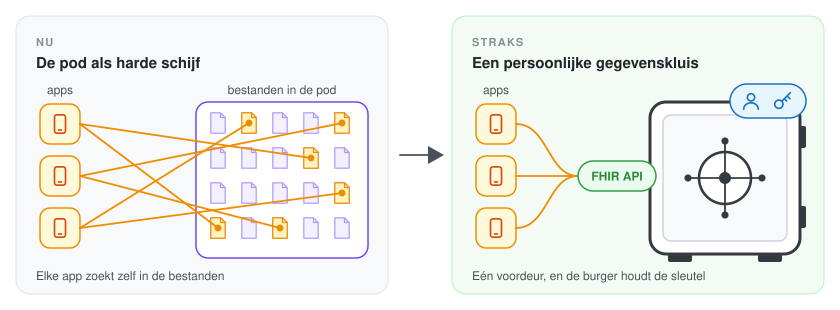

In de WellData-pilot lezen en schrijven apps FHIR-gegevens direct in de Solid pod van de burger. Die keuze werkt: apps kunnen gegevens in de pod opslaan en terugvinden. Maar in de pilot en het technisch overleg kwamen steeds dezelfde knelpunten terug: de gekozen representatie bepaalt hoe de gegevens bruikbaar zijn, en een model om specifiek toegang toe te kennen ontbreekt.

Deze memo stelt voor de interface los te maken van de opslag. Een kluisaanbieder biedt de persoonlijke gegevenskluis aan met drie onderdelen: een autorisatieservice op basis van OpenID Connect (de burger logt in bij de kluisaanbieder en geeft toestemming, de applicatie krijgt een access_token met SMART on FHIR-scopes), een FHIR API die de gegevens volgens een Implementation Guide beschikbaar maakt in lijn met de FAIR-principes, en een backend die primair werkt met openEHR en de pod*: de gegevens staan als openEHR-bestanden in de pod van de burger. Apps spreken dan alleen FHIR volgens dat contract.

*) Andere implementaties van de backend zijn mogelijk.

*Uit te werken: samenvatting herschrijven als de memo af is.*

## 1. De pilot en de gekozen oplossingsrichting

### 1.1 WellData en de pilot

WellData (Interreg Vlaanderen-Nederland, 2024 tot 2027) maakt leefstijl- en welzijnsgegevens uitwisselbaar tussen Solid pods in Vlaanderen en PGO's in Nederland, als voorbereiding op de European Health Data Space. Binnen werkpakket 3.2 is daarvoor een protocol ontwikkeld voor de opslag en uitwisseling van die gegevens: de [WellData Implementation Guide](https://gidsopenstandaarden.github.io/welldata-implementation-guide/), opgeleverd in mei 2025.

De eerste use case is fysieke activiteit, gemeten met wearables. Na een hackathon in april 2025 en pre-pilots in 2025 volgt een pilotstudie met burgers in Eindhoven, Vorselaar en Leuven. Apps van partners, zoals de Gezondheidsgids en wearable-apps, schrijven daarin vragenlijstantwoorden en metingen weg in de pod van de burger.

*Uit te werken: actuele stand en planning van de pilots (WP4) verifiëren en aanvullen.*

### 1.2 De gekozen oplossingsrichting

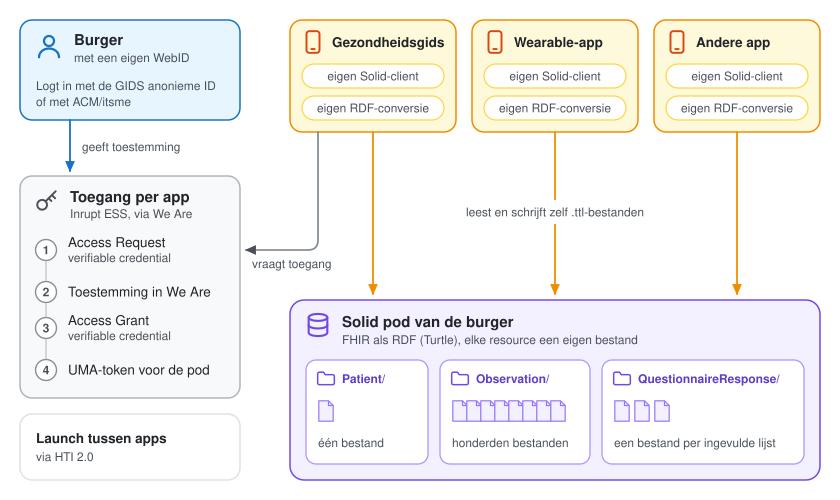

De IG legt de volgende opzet vast:

- **Opslag in de pod van de burger**, bij pod-platforms als Athumi en We Are.
- **FHIR R4 als gedeeld datamodel**, met profielen in de IG. De gegevens worden als RDF (Turtle) opgeslagen: elke resource een eigen bestand, in een container per FHIR-type ([Shared Dynamic Data](https://gidsopenstandaarden.github.io/welldata-implementation-guide/dynamic-data.html)). Apps lezen en schrijven die bestanden zelf. De IG zegt niet in zoveel woorden dat FHIR direct in de pod wordt geschreven, maar het volgt uit deze opslagstructuur.
- **Identiteit via WebID**, met inloggen via Solid-OIDC: in Nederland met de GIDS anonieme ID, in België met ACM/itsme.
- **Toegang via Access Grants**: een app vraagt toegang met een Access Request (een verifiable credential), de burger geeft toestemming, en de app wisselt de Access Grant via UMA in voor een token ([Pod Access](https://gidsopenstandaarden.github.io/welldata-implementation-guide/pod-access.html)).
- **Launch tussen apps** via HTI 2.0.

Die keuze is goed te verklaren. De burger houdt de eigen gegevens in beheer, en de pod-platforms in Vlaanderen bestonden al. FHIR is de gemeenschappelijke taal van de zorg, ook voor de Nederlandse PGO's. En RDF is de vorm waarin Solid gegevens opslaat, dus FHIR als RDF sluit aan op de standaarden die Solid ondersteunt. Sinds de hackathon van april 2025 werkt het lezen en schrijven in de pod ook in de praktijk.

## 2. Bevindingen en knelpunten

In de hackathon, de pre-pilots en het tweewekelijkse technisch overleg kwamen steeds dezelfde knelpunten terug. Ze hebben een gemeenschappelijke oorzaak: de opslag in de pod is tegelijk de interface voor applicaties.

### 2.1 Het formaat (de representatie) bepaalt het gebruik

FHIR is ontworpen als uitwisselformaat: het beschrijft hoe gegevens tussen systemen worden uitgewisseld, niet hoe ze worden opgeslagen. In WellData wordt FHIR ook als opslagformaat gebruikt. Daarmee wordt de keuze voor een representatie een keuze die het gebruik bepaalt.

Een voorbeeld. Observations kunnen afzonderlijk of samen in een Bundle worden opgeslagen. Worden ze afzonderlijk opgeslagen, zoals de IG nu voorschrijft, dan moet een app die één meting zoekt mogelijk honderden bestanden inlezen. Worden ze samen in een Bundle opgeslagen, dan moet de app mogelijk een Bundle met honderden Observations laden om er één uit te halen. Geen van beide representaties werkt goed voor alle vragen, en elke app moet de gekozen representatie kennen en volgen.

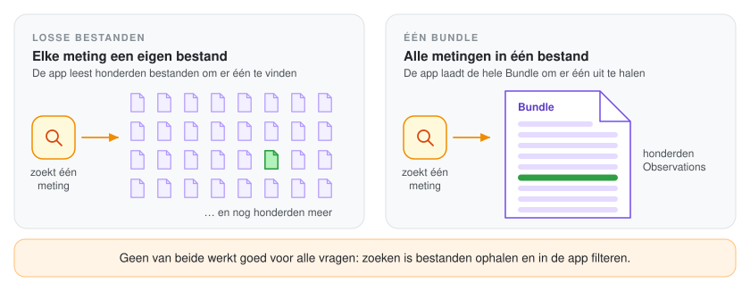

Daar komt bij dat queries op FHIR-resources in de pod onmogelijk of sterk beperkt zijn, ook als de gegevens als RDF zijn opgeslagen. Een querytaal zoals SPARQL is geen onderdeel van het Solid Protocol; zoeken komt neer op containers doorlopen en bestanden lezen.

*Uit te werken: rekenvoorbeeld (bijvoorbeeld de laatste gewichtsmeting opvragen); gevolgen van een nieuwe FHIR-versie voor opgeslagen gegevens; ervaringen uit de pre-pilot met overschrijven en vindbaarheid.*

### 2.2 Het ontbreken van gedetailleerde toegang

Toegang in Solid wordt verleend op containers en bestanden. De IG deelt de gegevens daarom in per FHIR-type, zodat een app bijvoorbeeld toegang krijgt tot de container met alle QuestionnaireResponses. Een andere indeling raakt dan weer de vindbaarheid en het zoeken uit 2.1. De opslagkeuze bepaalt zo het autorisatiemodel.

Een voorbeeld. Een burger heeft Garmin-gegevens in de kluis: hartslag, gewicht en slaapscore. De burger wil een coach-app alleen de slaapscore laten zien, niet het gewicht. In de pod staan al die metingen als Observations in dezelfde container. Toegang tot de container geeft toegang tot alles. Toegang per bestand kan, maar geldt niet voor metingen die later worden toegevoegd, en vraagt dat de app de bestanden al kent.

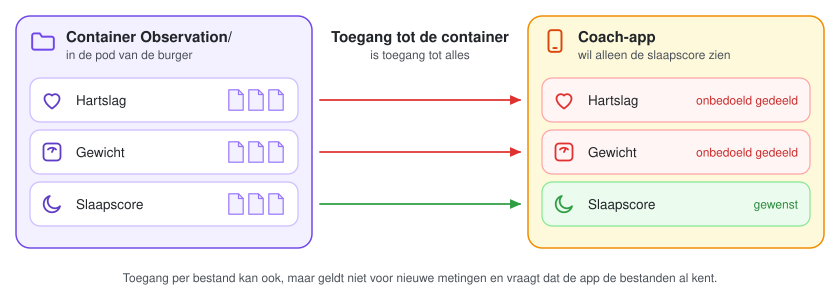

Daaruit volgen twee concrete beperkingen:

- **Geen model om specifiek toegang toe te kennen.** De huidige oplossing heeft wel een autorisatieservice: een app met een eigen WebID vraagt toegang met een Access Request (een verifiable credential), de burger geeft toestemming, en de app wisselt de Access Grant via UMA in voor een token. Wat ontbreekt is een model om uit te drukken welke gegevens een app mag zien: in termen van de gegevens zelf (type, code, periode), en op basis van attributen van de vrager, zoals rol, type applicatie of toepassing, medische context of breaking the glass.
- **Geen afgeschermd zoeken.** Een FHIR-server kan zoekresultaten beperken tot wat de vrager mag zien (search narrowing) en resources of onderdelen daarvan wegfilteren. In de pod krijgt een app de hele container of niets; filteren gebeurt pas in de app, nadat de gegevens al zijn opgehaald.

Langdurige toestemming is in de huidige oplossing geen knelpunt. Apps die zonder sessie van de burger gegevens schrijven, zoals een wearable-app die metingen synchroniseert, loggen in met eigen client credentials bij de We Are IDP en gebruiken de Access Grant om via UMA een token voor de pod te krijgen ([Client Authentication](https://gidsopenstandaarden.github.io/welldata-implementation-guide/technical-client-authentication.html)). Een Access Grant heeft een vervaldatum en is intrekbaar. In We Are gold de toestemming 24 uur; langer is technisch mogelijk en werd in het technisch overleg van augustus 2025 akkoord bevonden. Het nieuwe model moet dit minstens evenaren (zie 4.2).

*Uit te werken: concrete toegangsvragen uit de pilots.*

### 2.3 Verdere knelpunten

- **Validatie.** In de pre-pilot bleek dat er geen validatie was bij het schrijven naar de pod ("er is een IG maar geen profiel"). Inmiddels heeft de implementator van de pods schemavalidatie op basis van RDF geïmplementeerd. Validatie hangt daarmee af van de pod-implementatie, en is geen onderdeel van het contract.
- **Transacties.** Samenhangende resources, zoals een QuestionnaireResponse met de daarvan afgeleide Observations, worden als losse bestanden geschreven. Mislukt één schrijfactie, dan blijft de kluis inconsistent achter.
- **Versiebeheer.** Een FHIR-server houdt eerdere versies van een resource bij en maakt die opvraagbaar (`_history`). Het Solid Protocol schrijft geen versiebeheer voor.
- **Afgedwongen metadata en herkomst.** De pod-server houdt wel een eigen wijzigingstijdstip per bestand bij (`Last-Modified`), maar de FHIR-metadata in de RDF, zoals `meta.lastUpdated` en `meta.source`, schrijven apps zelf; niets garandeert dat die kloppen. Een FHIR-service dwingt de correctheid van metadata af: de server zet zelf het tijdstip en de versie (`Resource.meta`), en kan de herkomst vastleggen op basis van wie er schrijft. Koppeltaal 2.0 doet dat met de extensie resource-origin, die elke resource koppelt aan het Device van de schrijvende applicatie, afgeleid uit de OAuth-authenticatie.
- **Audit trail volgens NEN 7513 niet afgedwongen.** Apps lezen en schrijven direct in de pod; er is geen centraal punt dat elke toegang vastlegt. De IG noemt ATNA en correlatie-ID's, maar niets dwingt af dat wordt gelogd wie welke gegevens heeft ingezien of gewijzigd.
- **Clientbibliotheken en tooling** lopen achter; partners moesten bibliotheken forken en patchen.
- **Aggregatie voor onderzoek en de EHDS.** Onderzoek vraagt nu pull over veel pods. De European Health Data Space maakt dat breder: voor secundair gebruik moeten gegevens via toegangsorganen (Health Data Access Bodies) beschikbaar kunnen komen, en voor primair gebruik krijgt de burger rechten op inzage en delen. Met gegevens verspreid over losse pods, zonder gemeenschappelijke API en zonder manier om ze te vinden, is dat lastig.

*Uit te werken: per knelpunt het bewijs uit de pilot; welke EHDS-verplichtingen voor WellData-gegevens gelden.*

### 2.4 Wat Solid zelf biedt

*Uit te werken: Type Indexes, Solid Application Interoperability, Shape Trees, SHACL/ShEx-validatie en het Solid Notifications Protocol, en of die de knelpunten uit 2.1 tot en met 2.3 oplossen.*

## 3. De persoonlijke datakluis: FHIR-data met jouw zeggenschap

Wat als de kluis van de burger niet alleen gegevens bewaart, maar ze ook verstandig deelt? Dat is de kern van de oplossing: we maken de interface los van de opslag. De pod is dan geen harde schijf meer waarin elke app zelf moet zoeken, maar een persoonlijke gegevenskluis met één voordeur, die de taal van de zorg spreekt.

Een kluisaanbieder biedt die kluis aan, met drie onderdelen:

- **a) Een sleutel die de burger zelf uitgeeft: OpenID Connect met SMART on FHIR-scopes.** De burger logt in bij de eigen kluis, met DigiD of de GIDS private ID, en bepaalt wie wat mag zien: eenmalig, tijdelijk of langdurig. Een app krijgt precies de sleutel die bij die toestemming hoort, en niets meer.
- **b) Eén voordeur die de taal van de zorg spreekt: de FHIR API.** Apps lezen en schrijven via één standaardinterface, vastgelegd in de WellData IG en in lijn met de FAIR-principes. Elke FHIR-app kan direct aansluiten.
- **c) Een solide fundament: de backend met openEHR en de pod.** Daar worden de gegevens duurzaam bewaard, met versiebeheer en controleerbaar op wijzigingen: als openEHR-bestanden in de pod van de burger*.

*) Andere implementaties van de backend zijn mogelijk.

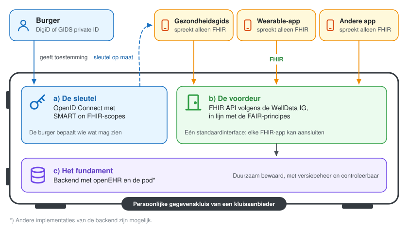

**Wat levert het op?**

- **Voor de burger: echte zeggenschap.** Niet alles of niets, maar precies delen wat nodig is, zoals alleen de slaapscore met de coach-app. En in de eigen kluis terugzien wie wat heeft ingezien.
- **Voor apps en leveranciers: eenvoud.** Een gewone OpenID Connect-client en een FHIR API, met standaardbibliotheken. Geen Solid-client, geen RDF-conversie, geen eigen opslagconventies.
- **Voor onderzoek en de EHDS: vindbaar en toegankelijk.** Via de NVI is te vinden waar gegevens staan; toegang loopt via de kluis, onder voorwaarden die de burger kent.
- **Voor het ecosysteem: bestaande standaarden.** FHIR, OpenID Connect en SMART on FHIR zijn dezelfde standaarden als in de rest van de zorg. Wat in WellData werkt, werkt daardoor ook daarbuiten.

Per knelpunt uit hoofdstuk 2 op een rij:

| Knelpunt | Huidige situatie | Met de kluisaanbieder |
| --- | --- | --- |
| 1. Representatie bepaalt gebruik | Elke app volgt de bestandsindeling en leest bestanden om te zoeken | De representatie ligt vast in het contract; zoeken via FHIR-zoekparameters, los van hoe de backend opslaat |
| 2. Gedetailleerde toegang | Toegang per container of per bestand; filteren pas in de app | SMART on FHIR-scopes in het access_token; de API weigert en filtert, ook bij zoeken |
| 3. Werk per app | Eigen Solid-client, RDF-conversie en opslagconventies | Alleen FHIR volgens de IG; validatie tegen de profielen en transacties in de API |
| Versiebeheer | Niet voorgeschreven | `_history` in de API; in de pod is elke versie een eigen bestand |
| Metadata en herkomst | Door apps zelf geschreven, niet gegarandeerd | Afgedwongen door de API: tijdstip, versie en herkomst, gekoppeld aan de geauthenticeerde applicatie |
| Audit trail | Niet afgedwongen | De API dwingt een audit trail af (NEN 7513); het audit trail staat in de pod van de burger |
| Onderzoek en EHDS | Pull over veel pods | Vindbaar via de NVI; toegang via de autorisatieservice, op basis van veronderstelde toestemming (opt-out) |

*Uit te werken: hoe de kluisaanbieder de overige knelpunten oplost (tooling).*

## 4. De oplossingsrichting in detail

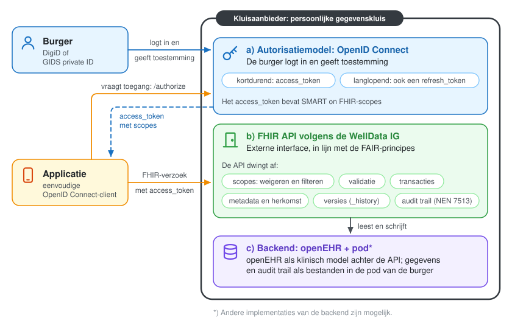

### 4.1 De FHIR API volgens de IG

We stellen voor een API vast te leggen, beschreven als FHIR Implementation Guide, met als thema de persoonlijke gegevenskluis. De API is het contract tussen applicaties en de kluis: welke gegevens de kluis bevat (profielen), welke lees-, schrijf- en zoekvragen ze ondersteunt (CapabilityStatement en zoekparameters), en welke SMART on FHIR-scopes ze afdwingt. Applicaties hoeven dan alleen FHIR volgens de IG te spreken.

De API dwingt af wat nu aan de apps wordt overgelaten:

- **validatie** tegen de profielen uit de IG, ongeacht de backend;
- **transacties** voor samenhangende resources;
- **metadata en herkomst**: de API zet tijdstip en versie, en legt vast welke applicatie een resource heeft geschreven, zoals Koppeltaal 2.0 dat doet met de extensie resource-origin;
- **versiebeheer**: eerdere versies blijven opvraagbaar via `_history`;
- **audit trail** volgens NEN 7513: elke toegang via de API wordt vastgelegd, en het audit trail staat in de pod van de burger.

De API beantwoordt zoekvragen zelf, uit de gegevens van één kluis. De opslag hoeft dus niet te kunnen zoeken: een lijst geven, lezen en schrijven is genoeg. Dat houdt de eisen aan de backend klein (zie 4.3).

De API sluit aan bij de FAIR-principes, die ook het uitgangspunt waren van het WP 3.2-protocol. Gegevens zijn opvraagbaar via een open, gestandaardiseerd protocol (FHIR REST), en dat protocol staat authenticatie en autorisatie toe waar nodig (FAIR A1, A1.1 en A1.2): FAIR betekent dus niet "open". Profielen, gecodeerde terminologie (SNOMED CT, LOINC) en referenties tussen resources dragen bij aan interoperabiliteit en herbruikbaarheid (I1 tot en met I3, R1.3), en afgedwongen herkomst draagt bij aan R1.2. Vindbaarheid over kluizen heen (F4) komt in 4.5 aan bod.

*Uit te werken: eerste schets van de CapabilityStatement, uitgaande van de huidige WellData-profielen; aansluiting bij bestaande API's voor persoonlijke gegevens; gebruiksvoorwaarden van persoonlijke gegevens (FAIR R1.1, bij persoonsgegevens de toestemming).*

### 4.2 Het autorisatiemodel: OpenID Connect

De huidige oplossing heeft al een autorisatieservice. Wat ontbreekt, is een eenvoudig model om specifiek toegang toe te kennen. We stellen voor het patroon te volgen dat MedMij gebruikt tussen een PGO (de afnemer) en een dienstverlener aan de bronzijde (DVA): de applicatie is de afnemer, de kluisaanbieder is de bron. Technisch is dat OpenID Connect, met de authorization code flow die ook de basis is van SMART App Launch.

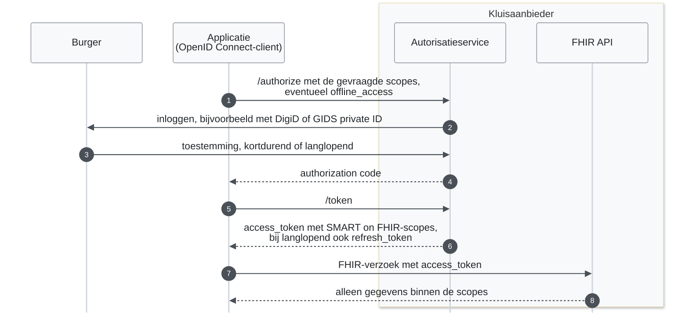

- **De bron identificeert de burger.** De autorisatieservice van de kluisaanbieder laat de burger inloggen, bijvoorbeeld met DigiD of de GIDS private ID (in België met ACM/itsme). De applicatie hoeft de burger daarvoor niet zelf te identificeren.
- **De burger geeft toestemming bij de bron.** In de /authorize-stap kiest de burger voor kortdurende toegang (alleen een access_token) of langlopende toegang (ook een refresh_token, met de scope `offline_access`). Bij elke vernieuwing met het refresh token controleert de autorisatieservice opnieuw of de toestemming nog geldt. Zo blijft een app die zonder sessie van de burger gegevens schrijft, gewoon werken.
- **De applicatie is een eenvoudige OpenID Connect-client.** Geen eigen WebID, geen verifiable credentials en geen UMA-ruil; standaardbibliotheken volstaan.
- **Scopes beschrijven wat er gedeeld wordt.** Het access_token bevat SMART on FHIR-scopes; de FHIR API dwingt die af door te weigeren en te filteren.

**Voorbeeld: alleen de slaapscore.** De burger uit 2.2 geeft een coach-app alleen toegang tot de slaapscore. De autorisatieservice geeft de app dan een access_token met een scope als `patient/Observation.rs?code=lifestyle-system|sleepscore` (de code is hier illustratief). Vraagt de app alle Observations op, dan levert de API alleen slaapscores; hartslag en gewicht verlaten de kluis niet. Dat geldt ook voor slaapscores die later worden toegevoegd. SMART App Launch 2 ondersteunt zulke scopes met zoekparameters, maar servers zijn daar nog niet toe verplicht; de IG moet dat dus eisen.

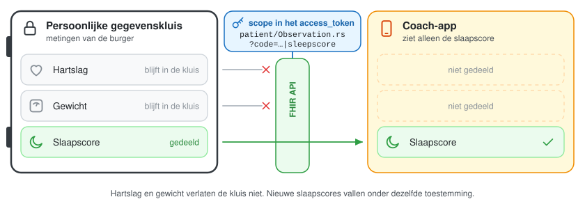

Op papier is dit gelijkwaardig aan de huidige pod-oplossing, maar veel eenvoudiger, en net als de FHIR API gebaseerd op bestaande standaarden:

|  | Huidige pod-oplossing | Voorgesteld |
| --- | --- | --- |
| Identificatie van de burger | Solid-OIDC via We Are (HTI-token met WebID) | Bij /authorize van de kluisaanbieder (DigiD, GIDS private ID) |
| Identificatie van de applicatie | Eigen WebID en client credentials bij de We Are IDP | OpenID Connect-client (client_id en clientauthenticatie) |
| Toestemming | Access Request (verifiable credential), goedkeuring in We Are, Access Grant (verifiable credential) | Toestemmingsstap in /authorize |
| Token voor toegang | Access Grant via UMA inruilen voor een token | access_token via /token |
| Langdurige toegang | Access Grant met vervaldatum, plus client credentials | refresh_token met `offline_access` |
| Granulariteit | Bestanden en containers | SMART on FHIR-scopes |

**Verdere autorisatielogica.** De autorisatieservice kan daarnaast rekening houden met andere attributen, zoals de rol van de gebruiker, het type applicatie of toepassing, de medische context en breaking the glass.

*Uit te werken: hoe identificatie met DigiD en de GIDS private ID (en in België ACM/itsme) bij de kluisaanbieder wordt ingericht; welke scopes en zoekparameters de IG voorschrijft; welke clientauthenticatie de IG eist; wat MedMij hiervoor al heeft vastgelegd en wat we kunnen hergebruiken; de HL7-codes voor purpose of use (waaronder break the glass); hoe de burger toestemming intrekt.*

### 4.3 De backend: openEHR en de pod

De backend van de kluisaanbieder werkt primair met openEHR en de pod: openEHR als klinisch model achter de API, met de gegevens als openEHR-composities in de pod van de burger, één compositie per bestand, en het audit trail daarnaast. Dat is een implementatiekeuze en geen onderdeel van de architectuur; de API zelf schrijft geen backend voor*.

*) Andere implementaties van de backend zijn mogelijk.

Applicaties spreken alleen FHIR. De backend moet dus elke resource vertalen naar openEHR en terug. Hoe die vertaling er precies uitziet, is nagegaan in de specificaties, de gepubliceerde archetypes en de open-source bruggen (stand 16 november 2026). Daarna volgt hoe de composities in de pod worden bewaard. De risico's die eruit volgen staan in hoofdstuk 5.

**Twee modellen met een andere eenheid.** FHIR kent losse resources, elk met een eigen id, die naar elkaar verwijzen. Eén generiek type, de Observation, dekt alle metingen; de betekenis zit in de `code`. openEHR kent per persoon één dossier (EHR) met daarin composities: documenten die als geheel worden opgeslagen en waarvan elke wijziging een nieuwe versie oplevert. Een compositie bevat entries, en elke entry volgt een archetype: een internationaal beheerd model van één klinisch concept, zoals lichaamsgewicht of bloeddruk. Een template legt vast welke archetypes samen één compositie vormen. De betekenis zit dus in de keuze van het archetype, niet in een code.

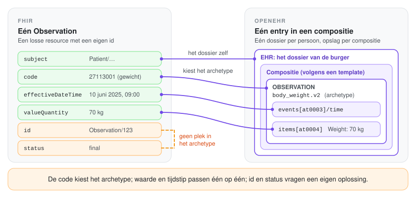

**Voorbeeld: een gewichtsmeting.** Een WellDataObservation met SNOMED-code 27113001 en de waarde 70 kg wordt een entry volgens het archetype [`openEHR-EHR-OBSERVATION.body_weight.v2`](https://github.com/openEHR/CKM-mirror/blob/master/local/archetypes/entry/observation/openEHR-EHR-OBSERVATION.body_weight.v2.adl):

| FHIR (WellDataObservation) | openEHR | Hoe het past |
| --- | --- | --- |
| `code` (27113001, lichaamsgewicht) | De keuze voor het archetype | De code kiest het archetype; terug naar FHIR vult de mapping de code als vaste waarde in |
| `valueQuantity` (70 kg) | Het element Weight, `items[at0004]`: een DV_QUANTITY met `magnitude` en `units` | Eén op één |
| `effectiveDateTime` | Het tijdstip van de meting, `events[at0003]/time` | Eén op één |
| `subject` | Het dossier zelf (`EHR_STATUS.subject`) | De persoon staat niet in de compositie, maar volgt uit het dossier |
| `performer` | De `composer` of een deelnemer van de compositie | Een verwijzing naar een partij buiten het dossier |
| `status`, `category`, `identifier` | Geen plek in het archetype | Vraagt extra archetypes die alleen een FHIR-veld dragen; de Duitse mappings doen dat met clusters als `observation_status_fhir` |
| `id`, `meta.versionId`, `meta.lastUpdated` | De uid en het versienummer van de compositie, het tijdstip van vastleggen | De backend moet bijhouden welk id bij welke compositie hoort |
| `derivedFrom` (een QuestionnaireResponse) | Een link naar een andere compositie | Werkt alleen als ook de vragenlijst is vertaald |

Zo'n koppeling wordt vastgelegd als mapping. In [FHIRconnect](https://sevkohler.github.io/FHIRconnect-spec/), een open notatie daarvoor, ziet de kern van dit voorbeeld er zo uit (uit de testbestanden van openFHIR):

```yaml
mappings:
  - name: "weight"
    with:
      fhir: "$resource.value"
      openehr: "$archetype/data[at0002]/events[at0003]/data[at0001]/items[at0004]"
  - name: "time"
    with:
      fhir: "$resource.effective"
      openehr: "$archetype/data[at0002]/events[at0003]/time"
```

**De vertaling is werk per archetype.** Er is niet één vertaling voor heel FHIR. Een mapping wordt geschreven per archetype (model mapping), per FHIR-profiel (extension mapping) en per template (context mapping). De engine [openFHIR](https://github.com/openFHIR/openfhir) voert de mappings uit, in beide richtingen. Voor de WellData-basisset geeft dat het volgende beeld:

- **Archetypes zijn er voor de meeste metingen.** De internationale bibliotheek van openEHR (de [CKM](https://github.com/openEHR/CKM-mirror), ruim 600 archetypes) bevat gepubliceerde archetypes voor gewicht, lengte, BMI, middelomtrek, bloeddruk, labuitslagen (cholesterol), roken en alcoholgebruik, en een compositie voor gegevens die de burger zelf aanlevert (`self_reported_data.v1`). De archetypes voor de samenvatting van lichaamsbeweging en voor de AUDIT-vragenlijst (met de AUDIT-C-score) zijn nog in ontwikkeling. Voor stemming en stress vonden we op naam geen archetype.
- **Mappings zijn er nog niet.** De [mappingbibliotheek van FHIRconnect](https://github.com/SevKohler/FHIRconnect-mapping-lib) (ruim honderd bestanden) dekt diagnoses, allergieën, medicatie, verrichtingen, labuitslagen en persoonsgegevens, voor Duitse (KDS), Europese (EEHRxF) en internationale (IPS) profielen. Mappings voor gewicht, lengte, bloeddruk, leefstijl en vragenlijsten ontbreken; alleen de testbestanden van openFHIR bevatten voorbeelden voor gewicht, lengte, BMI en bloeddruk. De mappings voor de WellData-profielen moeten dus zelf worden geschreven en onderhouden.
- **Vragenlijsten passen het minst.** openEHR modelleert elke vragenlijst als een eigen archetype, met de vragen als vaste elementen ([richtlijn voor PROM's](https://openehr.atlassian.net/wiki/spaces/healthmod/pages/3298263041/Guidelines+for+developing+PROM+archetypes)). Een generiek model met `linkId` en antwoorden, zoals de QuestionnaireResponse, kent openEHR niet, en de mappingbibliotheek bevat geen mapping voor Questionnaire of QuestionnaireResponse. Voor de WellData-vragenlijst blijven twee wegen over: zelf een archetype of template maken, of de antwoorden buiten openEHR bewaren en alleen de afgeleide metingen in openEHR opnemen.
- **De persoon staat buiten openEHR.** openEHR schrijft geen model voor persoonsgegevens voor. Het dossier verwijst alleen naar de persoon; naam, adres en identificatie staan in een aparte dienst, bij leveranciers meestal een FHIR-server of een demografieserver van openEHR, en FHIRconnect gaat daarvan uit. De WellDataPatient komt dus naast openEHR te staan, niet erin.

**De opslag: één compositie per bestand in de pod.** De composities staan als bestanden in de pod van de burger. Een openEHR-server is daarvoor niet nodig: de pod bewaart, de dienst van de kluisaanbieder doet de rest.

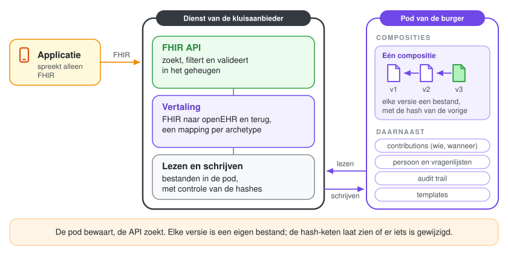

- **De vorm.** Elke compositie is één bestand, in het [canonieke JSON-formaat](https://specifications.openehr.org/releases/ITS-JSON/latest) van openEHR: hetzelfde formaat dat de REST API van openEHR gebruikt. Een RDF-vorm kent openEHR niet. De pod bewaart de bestanden daarom als gewone documenten en niet als RDF; dat kan, want een pod bewaart naast RDF ook elk ander bestand ongewijzigd.
- **Versies.** Een bestand wordt nooit overschreven. Elke wijziging levert een nieuwe versie op in een eigen bestand, in het versieformaat van openEHR ([change control](https://specifications.openehr.org/releases/RM/latest/common.html)): de compositie zelf, een verwijzing naar de voorgaande versie, en wie wat wanneer vastlegde. Verwijderen is ook een nieuwe versie, met de status verwijderd. Wijzigingen die bij elkaar horen worden samen beschreven in een contribution, ook een bestand.
- **De werkwijze.** Vraagt een applicatie gegevens op, dan leest de dienst de composities van die burger uit de pod, vertaalt ze met de mappings naar FHIR en beantwoordt de vraag uit het geheugen. Schrijft een applicatie, dan valideert de dienst de resource, vertaalt die naar een compositie en schrijft de nieuwe versie naar de pod. Pas als de pod de schrijfactie heeft bevestigd, bevestigt de API haar aan de applicatie.
- **Zoeken doet de API.** Omdat de dienst de gegevens van één kluis in het geheugen heeft, beantwoordt ze zoekvragen zelf: filteren op code, datum en status, sorteren en pagineren. De opslag hoeft alleen een lijst te geven, te lezen en te schrijven. Dat de pod geen querytaal heeft (2.1) is dan geen bezwaar meer.
- **Controle op wijzigingen.** Elke versie draagt de hash (SHA-256) van de voorgaande versie en een handtekening van de kluisaanbieder. Zo ontstaat een keten: bij het inlezen ziet de dienst of een bestand buiten de API om is gewijzigd of vervangen. Loopt de keten ook over de contributions, dan valt het bovendien op als een hele compositie is weggehaald. Het versieformaat van openEHR heeft een veld voor een handtekening of hash (`signature`), maar legt niet vast over welke vorm van de inhoud die wordt berekend; dat en de keten zijn dus een eigen invulling. De laatste hash van de keten wordt ook buiten de pod bewaard, anders valt het niet op als de nieuwste versies ontbreken.
- **Wat naast de composities staat.** Niet alles is een compositie. De persoon staat van huis uit buiten openEHR, voor vragenlijstantwoorden is er geen kant-en-klare vorm, en het audit trail van de API is geen klinisch gegeven. Die staan als eigen bestanden naast de composities in de pod, net als de templates die nodig zijn om de composities te lezen en te controleren.

We vonden geen gepubliceerd werk en geen product dat openEHR-composities in een Solid pod bewaart. Deze opzet moet dus zelf worden ontworpen en gebouwd (zie hoofdstuk 5).

**Wat de API belooft en de vertaling niet vanzelf regelt.** Een mapping vertaalt de inhoud van een resource. De API belooft meer (4.1), en dat moet de dienst zelf op de composities in de pod afbeelden:

- **Id's.** Een FHIR-resource heeft een eigen id, een entry in openEHR niet. Is elke resource één compositie, dan is het id van de compositie het id van de resource, het volgnummer van de versie de `meta.versionId` en het tijdstip van vastleggen de `meta.lastUpdated`. De tabel van resource naar compositie die de specificatie van FHIRconnect aanbeveelt, is dan niet nodig. Staan er meer resources in één compositie, dan is die tabel er wel, en moet de dienst haar zelf bijhouden: openFHIR bewaart geen klinische gegevens.
- **Zoeken.** De API zoekt zelf, in het geheugen. Een FHIR-zoekvraag hoeft dus niet te worden vertaald naar AQL, de querytaal van openEHR. Dat scheelt: de specificatie van FHIRconnect laat die vertaling open, en openFHIR kan haar alleen voor velden waarvoor een mapping bestaat en volgens de documentatie alleen voor vergelijken op gelijkheid. De grens ligt nu bij de omvang van één kluis: de dienst moet de composities inlezen voordat ze kan zoeken.
- **Versies en verwijderen.** Elke versie is een eigen bestand, dus `_history` is een kwestie van de eerdere bestanden lezen. Dat past zolang één resource één compositie is; staan er meer resources in één compositie, dan krijgen ze bij elke wijziging samen een nieuwe versie. Verwijderen is in openEHR logisch: de eerdere versies blijven staan. Echt wissen op verzoek van de burger breekt de keten en vraagt een eigen regeling.
- **Transacties.** Een pod kent geen transactie over meer bestanden. Eén resource schrijven is één bestand en dus ondeelbaar. Een FHIR-transactie met meer resources wordt een reeks bestanden; de contribution, die als laatste wordt geschreven, kan dan als bevestiging dienen: versies zonder contribution tellen bij het inlezen niet mee.
- **Gelijktijdig schrijven.** Twee applicaties kunnen tegelijk dezelfde resource wijzigen. Omdat een versie een nieuw bestand is, kan de dienst voorwaardelijk schrijven: het [Solid Protocol](https://solidproject.org/TR/protocol) raadt daarvoor `If-None-Match: *` aan, zodat een bestaand bestand niet ongemerkt wordt overschreven.
- **Validatie.** Zonder openEHR-server valideert de dienst zelf: de resource tegen de FHIR-profielen, en de compositie tegen de template. FHIRconnect beveelt aan een vertaling te laten mislukken als een verplicht veld ontbreekt; openFHIR meldt wat niet vertaald kon worden als waarschuwing. Een resource die geldig is volgens het WellData-profiel kan dus toch op de vertaling stuklopen.

**Wat openEHR oplevert.**

- **Opslag los van FHIR-versie en profiel.** De gegevens staan in archetypes, niet in een FHIR-vorm. Een nieuwe FHIR-versie of een ander profiel, bijvoorbeeld voor de EHDS, vraagt dan een nieuwe mapping en geen migratie van opgeslagen gegevens. Dat is de opzet van FHIRconnect; voor andere versies dan R4 is het volgens de specificatie nog weinig beproefd.
- **Versiebeheer en verantwoording in het model.** Elke wijziging is een nieuwe versie, verwijderen is een logische verwijdering, en bij elke vastlegging staat wie wat wanneer wijzigde. Die vorm is als bestand over te nemen, zonder openEHR-server.
- **Een open formaat in de pod.** De bestanden volgen een gepubliceerde standaard en zijn zonder de kluisaanbieder te lezen. De burger kan ze meenemen naar een andere kluisaanbieder, en ze kunnen in een openEHR-server worden geladen als de templates daar bekend zijn.
- **Een querytaal waar die nodig is.** AQL vraagt op de structuur van archetypes, binnen één dossier of over dossiers heen. In de pod is er geen AQL. Worden composities in een openEHR-server geladen, bijvoorbeeld voor onderzoek over kluizen heen, dan is AQL er wel.
- **Gedeelde klinische modellen.** Archetypes worden internationaal beheerd en hergebruikt, los van één leverancier.

**Hoe volwassen zijn de bruggen?** De dienst heeft een brug nodig die vertaalt, en bibliotheken om composities te lezen, te schrijven en te controleren.

- **FHIR Bridge.** De [FHIR Bridge van EHRbase](https://github.com/ehrbase/fhir-bridge) is op 8 april 2024 gearchiveerd. Ook de voortzetting, de [num-fhir-bridge](https://github.com/NUM-Forschungsdatenplattform/num-fhir-bridge), is gearchiveerd (laatste wijziging oktober 2024).
- **FHIR Connect en FHIRconnect.** De [oorspronkelijke specificatie van Better](https://github.com/better-care/fhir-connect-mapping-spec) wordt sinds 2024 niet meer onderhouden. De opvolger FHIRconnect is actief (laatste wijziging eind oktober 2026), maar is het resultaat van een onderzoeksproject; het beheer ligt bij de auteurs, niet bij openEHR of HL7. Het [bijbehorende artikel](https://arxiv.org/abs/2511.14618) beschrijft mappings van 24 archetypes naar 15 FHIR-profielen en rapporteert geen gemeten resultaten van een rondreis (FHIR naar openEHR en terug).
- **openFHIR.** Actief (versie 3.0.4 van 1 november 2026, Apache 2.0). De engine vertaalt en bewaart zelf geen klinische gegevens; dat past bij een dienst die de composities zelf in de pod bewaart. De open-sourceversie is volgens de makers niet bedoeld voor productie: authenticatie, koppeling met een terminologieserver en prestatie-optimalisaties zitten alleen in de betaalde versie.
- **Bibliotheken voor openEHR.** Er zijn actief onderhouden open-source bibliotheken, zoals [Archie](https://github.com/openEHR/archie) (Apache 2.0) en de [openEHR SDK](https://github.com/ehrbase/openEHR_SDK) van EHRbase. Of ze volstaan om composities en versies als bestanden te lezen, te schrijven en tegen een template te controleren, is niet beproefd.
- **HL7 en openEHR.** De twee organisaties werken sinds een [gezamenlijke workshop in juni 2025](https://blog.hl7.org/openehr-and-hl7-fhir-communities-forge-stronger-ties-for-future-collaboration-at-amsterdam-summit) samen in werkgroepen. Een door beide vastgestelde mapping vonden we niet.

*Uit te werken: de indeling van de bestanden in de pod (containers, bestandsnamen, de vorm van contributions en van wat naast de composities staat); de precieze vorm van de hash-keten en de handtekening; de keuze van brug en bibliotheken; templates en mappings voor de WellData-profielen; de uitkomst van een proef (zie hoofdstuk 6).*

### 4.4 Burgerregie, identiteit en portabiliteit

*Uit te werken: de rol van WebID, Solid-OIDC en HTI in de nieuwe opzet; hoe de burger in het audit trail ziet wie welke gegevens heeft ingezien; hoe de burger de eigen gegevens kan inzien en meenemen naar een andere kluisaanbieder.*

### 4.5 Onderzoek en de EHDS: vindbaar via de NVI

Voor onderzoek en voor secundair gebruik onder de EHDS moeten gegevens in persoonlijke gegevenskluizen vindbaar en opvraagbaar zijn, zonder dat iemand alle pods afloopt. De [Nationale Verwijsindex (NVI)](https://build.fhir.org/ig/nuts-foundation/nl-generic-functions-ig/branches/add-authorization-information-model/localization.html) uit de Generieke Functies, nu in consultatie, kan daarbij helpen. De NVI legt vast dat een partij gegevens van een bepaald type over een persoon heeft, en verwijst naar die partij.

Zo kan de NVI het FHIR-endpoint van de persoonlijke gegevenskluis publiceren. Bij dat endpoint vraagt een onderzoeker of toegangsorgaan via de autorisatieservice een access_token aan. De beslissing ligt dan bij hoe de autorisatieservice werkt en reageert: in principe alleen op basis van vooraf veronderstelde toestemming (opt-out) van de burger. Daarmee vult de NVI ook FAIR-principe F4 in: vindbaarheid via een doorzoekbare index.

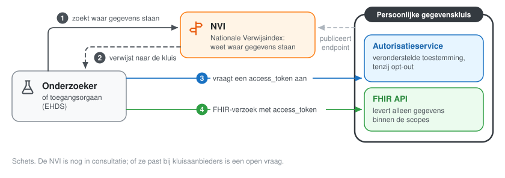

*Uit te werken: of de NVI, die nu uitgaat van zorgaanbieders (URA) en een gepseudonimiseerd BSN, past bij kluisaanbieders en bij WellData, waar BSN niet wordt gebruikt; hoe opt-out wordt vastgelegd en gecontroleerd.*

### 4.6 Verhouding tot Koppeltaal en MedMij

De persoonlijke gegevenskluis vervangt Koppeltaal en MedMij niet. Beide vertrekken vanuit de zorgaanbieder en diens dossier. De kluis vertrekt vanuit de burger, met gegevens die buiten de zorg ontstaan. Ze raken elkaar op één plek: de module en haar resultaten.

|  | Koppeltaal 2.0 | MedMij | Persoonlijke gegevenskluis |
| --- | --- | --- | --- |
| Van wie | Het domein van één zorgaanbieder | Tussen de aanbieder en het PGO van de persoon | De burger |
| Gegevens | Toewijzing en status van taken; geen metingen of vragenlijstantwoorden | Het dossier van de aanbieder, per gegevensdienst | Leefstijl en welzijn: metingen, vragenlijsten en antwoorden |
| Autorisatie | Per applicatie | Per persoon: toestemming bij de aanbieder | Per persoon: toestemming met SMART on FHIR-scopes |
| Modules starten | Vanuit een portaal of EPD | Vanuit het PGO (KoppelMij, in ontwikkeling) | HTI 2.0 in de huidige IG |
| Resultaten van modules | Nog niet gestructureerd | Informatiestandaarden voor vragenlijsten en zelfmetingen | Dit is wat de kluis bewaart |

**Koppeltaal: aanvullend.** [Koppeltaal 2.0](https://vzvznl.github.io/Koppeltaal-2.0-FHIR/) koppelt de applicaties van één zorgaanbieder: EPD, portalen en modules. Het wisselt uit welke module aan wie is toegewezen en wat de status is, en autoriseert per applicatie. Metingen en vragenlijstantwoorden horen niet bij de profielen. Koppeltaal is naar eigen zeggen een laag voor orkestratie, transport en autorisatie, en geen opslagsysteem ([Documenten delen](https://vzvznl.github.io/Koppeltaal-2.0-FHIR/documenten-delen.html), concept). De kluis is juist opslag, van één burger en op basis van toestemming. De kluis past daarom niet als deelnemer in een Koppeltaal-domein, en dat hoeft ook niet: de module slaat de brug. Ze is applicatie in het domein van de zorgaanbieder en tegelijk client van de kluis.

**MedMij: het spiegelbeeld.** In MedMij is het PGO de afnemer en de aanbieder de bron. In 4.2 is de kluis de bron en de applicatie de afnemer: hetzelfde patroon, met omgekeerde rollen. MedMij regelt de uitwisseling tussen het PGO en de aanbieder; toegang van een derde applicatie tot gegevens in het PGO regelt het niet. De API van de kluis vult dat aan. Het [MedMij Afsprakenstelsel](https://afsprakenstelsel.medmij.nl/) (versie 2.6) ondersteunt [vooralsnog alleen uitwisseling binnen de zorg](https://afsprakenstelsel.medmij.nl/asverplicht/mmverplicht/juridische-context), in brede zin. Een [addendum](https://afsprakenstelsel.medmij.nl/asverplicht/mmverplicht/addendum-aanbieder-zonder-behandelrelatie) laat ook aanbieders zonder behandelrelatie toe, maar dat is experimenteel en vraagt een wettelijke basis voor het BSN. Een leefstijl-app zonder die basis past daar niet in. Gegevens die buiten de zorg ontstaan, komen dus via de API in de kluis en niet via MedMij. MedMij wordt relevant op de grens met de zorg: als de burger gegevens uit de kluis met een zorgaanbieder deelt, of gegevens uit de zorg ophaalt. Dat kan als de kluisaanbieder ook PGO is, of als een PGO een applicatie op de kluis is.

**KoppelMij verbindt de twee al.** [KoppelMij](https://koppelmij.github.io/koppelmij-designs/overview.html) maakt taken van de zorgaanbieder zichtbaar en startbaar vanuit het PGO, met autorisatie per persoon. De ontwerpen onderscheiden vijf typen modules. Eén daarvan hoort bij het PGO-domein en deelt gegevens met het PGO (PGO-standalone). Hoe dat delen gaat, is in de ontwerpen niet uitgewerkt; de API van de kluis kan die invulling zijn.

**Use case: een module in twee werelden.** Sommige modules worden zowel buiten als in de zorg gebruikt. Voorbeelden zijn de vragenlijst over alcoholgebruik (de AUDIT-C, onderdeel van de Gezondheidscheck in de IG) en het gesprek over Positieve Gezondheid met het spinnenweb van iPH.

1. **In het burgerdomein.** De burger start de module zelf. De resultaten gaan naar de kluis.
2. **In de zorg.** De behandelaar wijst dezelfde module toe als taak, via Koppeltaal of via het PGO met KoppelMij. De resultaten horen in het dossier van de zorgaanbieder.
3. **De overgang.** Met toestemming van de burger leest de module eerdere antwoorden uit de kluis, zodat de burger niet opnieuw begint. Na afloop schrijft ze de resultaten terug, zodat de burger ze behoudt.

De twee voorbeelden verschillen. Het spinnenweb is volgens iPH een [gespreksinstrument en geen meetinstrument](https://iph.nl/iph-aanbevelingen-voor-het-meten-van-pg-handreiking): de eigen reflectie van de burger, die in de kluis past en die de burger als opening van een gesprek kan delen. De AUDIT-C is een screening met een score; in de zorg hoort dat resultaat ook in het dossier.

Voor de leverancier van de module vraagt dit één manier van starten, één vorm voor resultaten en twee autorisaties. Het starten ligt dicht bij elkaar: de IG gebruikt HTI 2.0, Koppeltaal een SMART on FHIR app launch met HTI. Voor resultaten ligt er een kans. Bij Koppeltaal is het gestructureerd delen van resultaten [het minst uitgewerkte onderwerp](https://vzvznl.github.io/Koppeltaal-2.0-FHIR/memo-koppelmij-scope.html), terwijl de WellData IG al profielen heeft voor Observation en QuestionnaireResponse. Kiezen beide dezelfde vorm, dan levert een module één resultaat voor twee bestemmingen: het dossier en de kluis.

**De grens tussen kluis en dossier.** Medische gegevens worden primair door de zorgverlener verwerkt; dat verandert niet. Gegevens steken de grens over als kopie. Wat de zorgverlener uit de kluis in het dossier opneemt, valt onder de zorgaanbieder. Wat de burger uit de zorg ophaalt, is de eigen kopie. De kluis wordt nooit het dossier van de zorgaanbieder. Deze lijn is nog niet juridisch getoetst.

*Uit te werken: de use case toetsen bij partners en leveranciers van modules; de juridische toets van de grens tussen kluis en dossier; de actuele stand van de MedMij-gegevensdiensten voor vragenlijsten en zelfmetingen.*

## 5. Risico's en open vragen

**Bij de backend met openEHR en de pod.** Het onderzoek naar de vertaling tussen FHIR en openEHR en de keuze voor composities als bestanden in de pod (4.3) leveren de volgende risico's op:

- **De bruggen zijn nog niet productierijp.** De FHIR Bridge is gearchiveerd. De open-sourceversie van openFHIR is volgens de makers niet bedoeld voor productie; wie de engine in productie wil gebruiken, komt uit bij de betaalde versie of bouwt de ontbrekende delen zelf.
- **De mappings voor WellData bestaan nog niet.** Voor metingen, leefstijl en vragenlijsten zijn er geen gepubliceerde mappings. Schrijven, testen en onderhouden ervan is blijvend werk, bij elke wijziging van een profiel of een archetype.
- **Vragenlijsten en welzijnsgegevens passen het minst.** Voor de vragenlijst is er geen generieke vorm in openEHR, en voor stemming en stress vonden we geen archetype. Juist die gegevens zijn de kern van WellData.
- **Verlies bij de rondreis is niet gemeten.** Er zijn geen gepubliceerde resultaten van FHIR naar openEHR en terug. FHIR-velden zonder plek in een archetype, zoals `status`, `category` en `identifier`, gaan verloren tenzij er extra archetypes voor worden gemaakt.
- **Het beheer van de mappingtaal ligt bij een onderzoeksgroep.** FHIRconnect is niet door openEHR of HL7 vastgesteld; de eerdere specificatie van Better is al gestopt.
- **openEHR in een pod is nieuw.** Er is geen product en geen standaard voor. Versies, contributions, de hash-keten en het afbeelden van id's, verwijderen en transacties bouwt de kluisaanbieder zelf. Daar zit het meeste eigen bouwwerk, en dus het meeste risico op afwijkingen van het contract.
- **Alles inlezen kost tijd.** De dienst leest de composities van een kluis in voordat ze kan antwoorden. Het aantal bestanden groeit met elke meting en elke versie; bij wearables die vaak meten loopt dat snel op. Een samenvattend bestand in de pod of een cache bij de kluisaanbieder kan het inlezen versnellen, maar is een afgeleide: de composities blijven de bron.
- **Geen transactie over bestanden.** Valt de dienst of de pod uit midden in een reeks schrijfacties, dan staat een deel in de pod. De contribution als bevestiging vangt dat op, maar moet nog worden ontworpen en getest.
- **Schrijven buiten de API om.** Zolang applicaties of de burger ook direct in de pod kunnen schrijven, kan de inhoud afwijken van wat de API heeft vastgelegd. De hash-keten maakt dat zichtbaar, maar voorkomt het niet, en ze werkt alleen als de laatste hash ook buiten de pod staat.
- **Zoeken over kluizen heen.** De API zoekt binnen één kluis. Onderzoek over veel kluizen (4.5) vraagt per kluis een eigen vraag aan de API, of een aparte voorziening waarin composities met toestemming worden samengebracht.

Deze risico's raken de applicaties niet zolang de API het contract is: de backend kan zich ontwikkelen zonder dat het contract verandert*.

*) Andere implementaties van de backend zijn mogelijk.

Open vragen bij de backend:

- Wat is één compositie: één resource, of alles wat in één keer wordt vastgelegd, zoals een ingevulde vragenlijst met de afgeleide metingen of de metingen van één synchronisatie? Eén resource per compositie houdt id's, versies en verwijderen eenvoudig; meer per compositie scheelt bestanden.
- Hoe worden de bestanden in de pod ingedeeld, en in welke vorm staan de persoon, de vragenlijstantwoorden en het audit trail naast de composities?
- Wie bewaart de laatste hash van de keten buiten de pod: de kluisaanbieder, of een onafhankelijke partij?
- Blijft directe toegang tot de pod bestaan naast de API, en zo ja alleen om te lezen?
- Hoe verhoudt logisch verwijderen zich tot echt wissen op verzoek van de burger?
- Horen templates en mappings bij de IG, zodat kluisaanbieders met openEHR dezelfde vertaling gebruiken, of zijn ze van elke kluisaanbieder zelf?
- Is er in Nederland en België genoeg kennis en gebruik van openEHR? Een eerste zoektocht vond in Nederland een stichting openEHR Nederland en enkele leveranciers die op openEHR bouwen (onder meer Code24 en Nedap), en in België niets; dat is niet verder onderzocht.

Open vragen bij de verhouding tot Koppeltaal en MedMij (4.6):

- Kiezen de WellData IG en Koppeltaal dezelfde vorm voor de resultaten van modules (Observation en QuestionnaireResponse, met dezelfde codes), zodat een module één resultaat levert voor het dossier en voor de kluis?
- Wordt de kluisaanbieder ook PGO binnen MedMij, of is een PGO een applicatie op de kluis? Het eerste vraagt profielen op basis van zibs, kwalificatie per gegevensdienst en het MedMij-label.
- Kan de burger bij de kluisaanbieder met DigiD inloggen (4.2)? In het technisch overleg viel DigiD begin 2025 af, omdat alleen partijen die het BSN mogen verwerken het kunnen gebruiken. In MedMij is het de aanbieder die DigiD afneemt, niet het PGO.

*Uit te werken: overige risico's en open vragen.*

## 6. Aanbevelingen en vervolgstappen

- **Beproef de vertaling en de opslag in de pod vroeg.** Een korte proef zonder openEHR-server: een brug die vertaalt en een dienst die composities als bestanden in een pod leest en schrijft, voor één meting (gewicht) en één vragenlijst. Schrijven, lezen, zoeken, wijzigen en verwijderen gaan via de API, met dezelfde end-to-end-tests als voor de API zelf. De proef laat zien hoeveel werk de mappings zijn, wat bij de rondreis verloren gaat, hoe lang het inlezen duurt bij een groeiende kluis en of de hash-keten doet wat ze moet doen.

*Uit te werken: overige aanbevelingen en vervolgstappen.*
