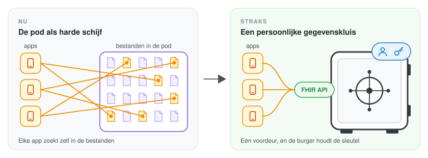

# WellData: verslag van de betrokkenheid van Stichting Nuts

- **Status:** concept
- **Datum:** 13 november 2026
- **Voor:** de Nuts community
- **Opgesteld door:** Roland Groen, ICT-architect namens Stichting Nuts
- **Bronnen:** het logboek van werkpakket 3.2 (oktober 2024 tot en met mei 2026), de projectmap van Stichting Nuts, de [WellData Implementation Guide](https://gidsopenstandaarden.github.io/welldata-implementation-guide/) en de bijbehorende repositories

> [!NOTE]
> Concept. Het logboek loopt tot 28 mei 2026 en het testbord op GitHub tot juni 2026. Nog aan te vullen: de stand van de pilot daarna (hoofdstuk 3) en de route die na het incident met Microsoft Authenticator voor de GIDS anonieme ID is gekozen (paragraaf 5.3).

## Samenvatting

Stichting Nuts is partner in WellData, het Interreg-project "Data Ruimte voor Preventie" van Vlaanderen en Nederland (mei 2024 tot en met april 2027). Het project maakt gegevens over leefstijl en welzijn uitwisselbaar tussen persoonlijke datakluizen in Vlaanderen (Solid pods) en persoonlijke gezondheidsomgevingen in Nederland, als voorbereiding op de European Health Data Space (EHDS). De burger houdt daarbij zelf de regie.

Wij coördineerden het technische werkpakket 3.2: het protocol voor gestandaardiseerde opslag en uitwisseling. Dat protocol is in mei 2025 opgeleverd als openbare FHIR Implementation Guide (IG). De IG beschrijft hoe apps uit twee landen dezelfde burger herkennen, toegang krijgen tot diens kluis, elkaar kunnen starten en dezelfde gegevens lezen en schrijven. Op een hackathon in april 2025 lazen en schreven apps van verschillende leveranciers voor het eerst dezelfde gegevens in de pod. Sindsdien ondersteunen wij de partners bij het inbouwen en testen.

De belangrijkste lessen:

- **Identiteit over de grens is het lastigste onderdeel.** DigiD is alleen bruikbaar voor partijen die het BSN mogen verwerken. In Nederland werkt WellData daarom met de GIDS anonieme ID, in België met itsme. Toen Microsoft Authenticator in mei 2026 zelfgehoste uitgevers van credentials ging weigeren, bleek hoe kwetsbaar de afhankelijkheid van één wallet-app is.
- **Een pod is opslag, geen applicatielaag.** FHIR-gegevens direct in een Solid pod lezen en schrijven werkt, maar zoeken, fijnmazige toegang, validatie en herkomst blijven dan het probleem van elke app.
- **Toestemming voor onderzoek vraagt een eigen route.** Wij stelden een model voor met een vertrouwde derde partij en verifiable credentials, in plaats van toestemming per app.

Uit die lessen volgt ons voorstel voor het vervolg: de persoonlijke gegevenskluis, waarin een kluisaanbieder de opslag afschermt met een FHIR API en een autorisatiemodel op basis van OpenID Connect en SMART on FHIR. Dat voorstel werken wij nu uit, met een referentie-implementatie. Wij nodigen de community uit om mee te lezen en mee te denken.

## 1. Het project in het kort

WellData heet officieel "Data Ruimte voor Preventie" en valt onder Interreg VI A Vlaanderen-Nederland, medegefinancierd uit het Europees Fonds voor Regionale Ontwikkeling. Het project loopt van 1 mei 2024 tot en met 30 april 2027. VITO is leadpartner. In het consortium zitten kennisinstellingen, zorg- en welzijnsorganisaties, lokale overheden en leveranciers uit beide landen, onder meer TNO, TU/e, Thomas More, Avans, CIC West-Brabant, Sport Vlaanderen en Domus Medica.

De aanleiding: de zorg staat onder druk en gegevensstromen draaien om ziekte. Gezondheid, leefstijl en welzijn worden nauwelijks op een vergelijkbare manier gemeten, en wat wel wordt gemeten blijft in losse apps zitten. WellData wil die gegevens uitwisselbaar maken, met de burger in regie, zodat de grensregio klaar is voor de EHDS.

| Werkpakket | Inhoud |
| --- | --- |
| WP1 en WP2 | Projectmanagement en communicatie |
| WP3 | Randvoorwaarden: een basisset van gezondheidsvariabelen (3.1), een protocol voor opslag en uitwisseling (3.2), ELSA en toestemming (3.3) |
| WP4 | Fieldlabs: co-creatie, pre-pilots en pilots met burgers |
| WP5 | Ecosysteem, businessmodel en een roadmap naar de EHDS |

De eerste use case is fysieke activiteit, gemeten met wearables. Het platform dat in het project wordt gebouwd is een demonstratie- en onderzoeksinstrument, geen eindproduct. De beoogde pilotstudie omvat circa 450 burgers in Eindhoven, Vorselaar en Leuven.

Een voorwaarde van de subsidieverlener is dat de rapporten en tools uit onder meer 3.2 gratis beschikbaar zijn voor alle geïnteresseerden. De Implementation Guide is daarom openbaar, en ook voor de Nuts community vrij te gebruiken.

## 2. Waarom Nuts meedoet, en in welke rol

WellData speelt zich af buiten de muren van de zorg: het gaat over preventie, leefstijl en welzijn, met de burger zelf als middelpunt. Dat past bij de beweging die Nuts voorstaat: van zorg naar gezondheid, van ketens naar netwerken, op basis van open standaarden en zelfbeschikking over identiteit en gegevens.

Bij de kick-off in mei 2024 hebben wij vier leervragen meegegeven:

1. Wat zijn de praktische gevolgen van de EHDS?
2. Waarin verschillen Nederlandse en Belgische persoonlijke datakluizen?
3. Hoe vertaal je coöperatieve toestemming naar techniek?
4. Volstaan eIDAS 2.0 en Trust over IP om op te schalen?

Nuts is partner in WP3 en WP4. Onze opdracht uit de aanvraag: samen met VITO de architectuur ontwerpen voor identificatie, authenticatie en toestemming over de grens, en de partners helpen die in te bouwen. Stichting Nuts heeft geen eigen personeel. Het werk wordt uitgevoerd door Sergej van Middendorp (projectleider, Miles Ahead) en Roland Groen (ICT-architect, Headease), die in het najaar van 2024 via een uitvraag in de Nuts community is aangetrokken.

Binnen het consortium is Nuts task lead van WP 3.2. Wij werken in maandelijkse sprints met een sprintreview, een tweewekelijks technisch overleg met de ontwikkelaars van de partners en, sinds maart 2026, een wekelijkse stand-up. Besluiten staan in een gedeeld logboek, het werk op een GitHub-projectbord en de resultaten in de Implementation Guide. Sinds de formele oplevering van het protocol adviseren wij vanuit de IG en ondersteunen wij de partners in WP4.

## 3. Wat we hebben gedaan

| Periode | Wat er gebeurde |
| --- | --- |
| Okt tot dec 2024 | Start van het technisch overleg met VITO, TU/e en de leveranciers. Verkenning van het toegangsmodel van Solid naast dat van Nuts. Agile werkwijze met sprintreviews en één product owner. Eerste varianten voor het delen van onderzoeksdata. |
| Jan tot mrt 2025 | User stories voor de apps van de partners. Ontwerp om de GIDS anonieme ID een WebID te geven, zodat Nederlandse gebruikers een pod kunnen gebruiken. DigiD valt af. Een "landkaart" van standaarden, en het besluit om het protocol als FHIR Implementation Guide op GitHub Pages te publiceren. Technische memo over het scheiden van persoonlijke en geaggregeerde gegevens. |
| 2 apr 2025 | Hackathon in Valkenswaard. Apps van verschillende leveranciers lezen en schrijven dezelfde gegevens in de pod. De launch tussen apps met HTI is deels gerealiseerd. |
| Apr tot mei 2025 | Voorstel voor toestemming bij onderzoeksdata. Keuze voor de GIDS anonieme ID naast itsme. **Op 20 mei 2025 is het protocol van WP 3.2 formeel afgerond en gerapporteerd aan Interreg.** |
| Jun tot okt 2025 | FHIR-resources en voorbeelden in de IG, samen met VITO en Zipster. Koppeling van de anonieme ID aan de identity provider van VITO. Pre-pilots met burgers. Review van het protocol voor onderzoeksdata en verkenning van FAIR Data Points. Eerste versie van de FHIR-profielen (IG 0.1.0, 30 oktober). |
| Nov 2025 tot jan 2026 | IG 0.1.1 en 0.1.2 met ruimere profielen, meer voorbeelden en RDF-uitvoer. Een eerste uitwerking van een FHIR API bovenop de pod. Single sign-on via HTI werkt. |
| Feb tot apr 2026 | Ondersteuning bij het inbouwen: naamgegevens volgens de zib, granulariteit van sensordata, indeling van de pod. Good practices uit de Nuts community gedeeld met de partners. VITO vervangt de diensten van Inrupt door eigen diensten. De start van de test met de partners verschuift naar 20 april; bevindingen staan op een gedeeld GitHub-bord. |
| Mei tot jun 2026 | Microsoft Authenticator weigert vanaf 5 mei zelfgehoste uitgevers van credentials. Beslissingsdocument met alternatieven (26 mei). WebAuthn-login van GIDS ingericht voor het We Are-platform van VITO (28 mei). |
| Jul tot nov 2026 | De analyse van FHIR direct in de pod tegenover een FHIR API (april 2026) uitgewerkt tot de memo "Van harde schijf naar persoonlijke gegevenskluis". Start van een referentie-implementatie. |

## 4. Wat het heeft opgeleverd

### 4.1 De WellData Implementation Guide

Het protocol van WP 3.2 is de [WellData Implementation Guide](https://gidsopenstandaarden.github.io/welldata-implementation-guide/): openbaar, gepubliceerd via GIDS Open Standaarden en gebouwd met de standaard FHIR-tooling. VITO en Zipster schreven mee. De IG beschrijft:

- **Identiteit.** Elke gebruiker heeft een WebID en logt in via Solid-OIDC: in België met itsme (via ACM), in Nederland met de GIDS anonieme ID. Eén OIDC-broker bij VITO verbindt beide.
- **Toegang tot de pod.** Een app vraagt toegang met een Access Request, de burger geeft toestemming, en de app wisselt de Access Grant via UMA in voor een token. Request en grant zijn verifiable credentials.
- **Launch en single sign-on.** Apps starten elkaar met HTI 2.0, de open standaard van GIDS, waarbij de WebID van de gebruiker meegaat.
- **Het gedeelde datamodel.** FHIR R4, met profielen voor Patient, Observation, Questionnaire en QuestionnaireResponse en uitgewerkte voorbeelden, opgeslagen als RDF (Turtle) in de pod.
- **Onderzoeksdata.** Een model voor gedelegeerde toestemming (zie 4.3).
- **Een technische walkthrough.** Stap voor stap, met HTTP-voorbeelden, voor ontwikkelaars die willen aansluiten.

De IG staat op versie 0.1.2 (december 2025) en heeft de status concept. Het FHIR-package heet `fhir.gidsopenstandaarden.welldata`.

### 4.2 Een werkende keten over de grens

De use case van de hackathon van 2 april 2025: een app krijgt toegang tot de pod en slaat een meting op, de gebruiker wordt doorgestuurd naar een tweede app, en die leest de meting en vult de gegevens aan. Lezen en schrijven in de pod lukte die dag bij beide leveranciers; de launch met HTI was deels klaar, en in december 2025 werkte single sign-on via HTI. Daarna is de keten uitgebouwd met het WellData-portaal, het We Are-platform van VITO en de apps van de partners, waaronder Zipster en de Gezondheidsgids.

### 4.3 Een voorstel voor toestemming bij onderzoek

Voor het delen van gegevens met onderzoekers en beleidsmakers hebben wij een model van gedelegeerde toestemming beschreven. De burger geeft toestemming, met voorkeuren, aan een vertrouwde derde partij (TTP). Die partij beoordeelt onderzoekers en geeft hun een verifiable credential. De gegevensbron levert alleen geanonimiseerde gegevens, en alleen als de vraag past bij de toestemming. De vertrouwensrelaties lopen via het Nuts-netwerk. Het ontwerp staat in de IG ([Research Data Overview](https://gidsopenstandaarden.github.io/welldata-implementation-guide/research-data-overview.html)) en is met de partners besproken, in samenhang met FAIR Data Points (HealthDCAT-AP) en ODRL voor het vastleggen van toestemming.

### 4.4 Bouwstenen

- De [broncode van de IG](https://github.com/GIDSOpenStandaarden/welldata-implementation-guide), met de [FHIR-profielen](https://gidsopenstandaarden.github.io/welldata-implementation-guide/artifacts.html#1) en [voorbeelden](https://gidsopenstandaarden.github.io/welldata-implementation-guide/artifacts.html#2) (open source).
- De [ephemeral FHIR service](https://github.com/GIDSOpenStandaarden/welldata-ephemeral-fhir-service): een eerste uitwerking van een FHIR API bovenop een pod, met tests en een demo-client (open source).
- De uitbreiding van de GIDS anonieme ID met een WebID, zodat die als inlogmiddel voor een Solid pod werkt. De werking staat beschreven in de technische walkthrough van de IG.

### 4.5 Kennisdeling

- Presentaties bij de kick-off (mei 2024), de partnermeeting (februari 2025), Platform IZO (maart 2025) en het Digital Transformation Event van TU/e over Nuts en de EHDS (mei 2025).
- Achtergrondmateriaal voor de partners over eIDAS 2.0, wallets, verifiable credentials en DID's.
- Good practices uit de Nuts community voor een implementatie met meerdere partijen: Slack als kanaal voor support, de beschrijving van een toepassing op Nuts als voorbeeld, en de aansluitovereenkomst voor productiegebruik.
- Een beslissingsdocument over het incident met Microsoft Authenticator, voor WellData en andere gebruikers van de GIDS anonieme ID.

## 5. Wat we hebben geleerd

### 5.1 Solid en Nuts spreken verwante talen

Het toegangsmodel van Solid blijkt verwant aan dat van Nuts. Identiteiten zijn URL's (WebID's, vergelijkbaar met did:web), toestemming is een verifiable credential, en een credential samen met een id_token werkt als een presentatie. De verschillen zijn te overbruggen; in de eerste weken ontstond zelfs het idee dat Nuts een WebID-profiel zou kunnen ondersteunen. Na de hackathon kwam daar een inzicht bij: de identity provider in Solid is eigenlijk een autorisatieserver die beslist of een applicatie mag meedoen. Dat is een rol die je ook decentraal kunt invullen: een vertrouwde bron geeft de applicatie een credential, en de applicatie toont dat op het moment van toegang.

### 5.2 Identiteit over de grens is het lastigste onderdeel

Het meeste overleg ging over de vraag hoe een burger inlogt. DigiD viel af: alleen partijen die het BSN mogen verwerken kunnen het gebruiken, en voor preventie is het te omslachtig. In België is itsme gangbaar, maar Nederlandse burgers kennen dat middel nauwelijks. Wij kozen voor de GIDS anonieme ID naast itsme: een inlogmiddel op basis van een wallet, zonder BSN, dat aansluit op de techniek en governance van de komende Europese identiteitswallet.

De Nederlandse pre-pilots van de partners in WP4 (33 bezoekers op pop-uplocaties, 7 deelnemers aan verdiepende sessies) laten de keerzijde zien. Inloggen is een vertrouwensmoment: burgers vertrouwen DigiD het meest, kennen eIDAS en itsme nauwelijks, en vinden Microsoft Authenticator "minder officieel" aanvoelen. Ook het begrip gegevenskluis blijkt lastig: men verwart het met cloudopslag, patiëntportalen en PGO's.

### 5.3 Eén wallet-app is een kwetsbaarheid

Sinds 5 mei 2026 kunnen nieuwe gebruikers geen GIDS anonieme ID meer ontvangen via Microsoft Authenticator. Uit analyse van de app bleek dat die alleen nog de eigen Verified ID-domeinen van Microsoft toelaat. Zelfgehoste uitgevers worden geweigerd, en aan de serverkant is daar niets aan te doen. Het beslissingsdocument van 26 mei adviseert voor WellData een alternatief pad: een wallet die OID4VCI ondersteunt (Sphereon), met WebAuthn als reserve. Op 28 mei is een WebAuthn-login van GIDS gekoppeld aan het We Are-platform.

De les reikt verder dan dit project. Kies voor een protocol (OID4VCI en OID4VP) en niet voor een wallet, laat de gebruiker de wallet kiezen, ondersteun als uitgever meerdere wallets, en houd een terugvaloptie achter de hand. De Nuts community kent dit vraagstuk uit het werk met organisatie- en persoonswallets.

### 5.4 Een pod is opslag, geen applicatielaag

In WellData lezen en schrijven apps FHIR-gegevens direct in de pod: elke resource een eigen bestand, in een map per FHIR-type. Dat werkt, en het sluit aan op de standaarden van Solid. In de hackathon, de pre-pilots en de tests kwamen wel steeds dezelfde knelpunten terug:

- **Zoeken.** Het Solid Protocol kent geen querytaal. Een app die één meting zoekt, leest mogelijk honderden bestanden.
- **Toegang.** Toegang geldt per map of per bestand. Een burger kan niet zeggen: wel mijn slaapscore, niet mijn gewicht.
- **Kwaliteit.** Validatie hangt af van de implementatie van de pod. Transacties, versiebeheer en herkomst zijn geen onderdeel van het contract; elke app moet die zelf goed regelen.
- **Tooling.** De clientbibliotheken lopen achter; een bibliotheek moest worden geforkt en gepatcht.

De gemeenschappelijke oorzaak is dat de opslag tegelijk de interface voor applicaties is. Ons beeld na twee jaar: het idee van Solid is in de kern goed, maar een pod gedraagt zich als een harde schijf. Het gaat pas werken met een laag ervoor die authenticatie, autorisatie en een API regelt.

### 5.5 Toestemming voor onderzoek vraagt een eigen route

Een eerste idee in het project was een datahub die met toestemming doorlopend gegevens uit de pods haalt. Dat botst met het uitgangspunt van Solid, waarin delen gebonden is aan een sessie van de gebruiker, en het leidt tot vergeten toestemming: gegevens blijven stromen terwijl de burger niet meer weet dat hij dat ooit heeft toegestaan. Toestemming in elke app apart inbouwen vonden de partners te zwaar. Het model met een vertrouwde derde partij (zie 4.3) is daar ons antwoord op. Het is beschreven en besproken; een beproeving in de praktijk was bij het afsluiten van het logboek nog niet gedaan.

### 5.6 Samenwerken over grenzen en werkpakketten heen

- **Zonder product owner strandt de techniek.** In de eerste maanden wisten wij wat technisch kon, maar niet wat nodig was. User stories als brug tussen WP4 en WP3, en één product owner, brachten de richting.
- **Een hackathon werkt als eerste toets.** Eén dag met de ontwikkelaars aan tafel liet zien dat lezen en schrijven in de pod werkt. Dat onderdeel was vooraf gekozen omdat het het meest risicovol en het meest informatief was.
- **Documentatie als product.** De IG is een levend document waar partners zelf aan bijdragen; het logboek en het GitHub-bord maken besluiten en bevindingen vindbaar.
- **De landen verschillen meer dan de techniek.** De inlogmiddelen en de eIDAS-praktijk lopen uiteen, net als de achtergrond van de partners. Ons advies aan het project is om de gekozen standaarden in te brengen in de landelijke programma's van beide landen.

## 6. Vooruitblik: van harde schijf naar persoonlijke gegevenskluis

De bevindingen uit 5.4 werken wij uit in de memo [Van harde schijf naar persoonlijke gegevenskluis](memo-persoonlijke-gegevenskluis.md), nu nog een werkdocument. De kern: maak de interface los van de opslag. Een kluisaanbieder biedt de kluis van de burger aan met drie onderdelen:

- **Een autorisatieservice op basis van OpenID Connect.** De burger logt in bij de eigen kluis en geeft toestemming; de app krijgt een access_token met SMART on FHIR-scopes. Het patroon is dat van MedMij, met de app als afnemer en de kluis als bron. Zo kan een burger een coach-app alleen de slaapscore laten zien.
- **Een FHIR API volgens de Implementation Guide.** Eén standaardinterface die validatie, transacties, versiebeheer, herkomst en een audit trail volgens NEN 7513 afdwingt, in lijn met de FAIR-principes.
- **Een backend die primair werkt met openEHR en de pod\*.** Daar worden de gegevens duurzaam en doorzoekbaar bewaard.

\*) Andere implementaties van de backend zijn mogelijk.

Voor de Nuts community is vooral de aansluiting op de Generieke Functies interessant. De Nationale Verwijsindex (NVI) kan het FHIR-endpoint van een persoonlijke gegevenskluis vindbaar maken voor onderzoek en voor secundair gebruik onder de EHDS. Of de NVI, die nu uitgaat van zorgaanbieders en een gepseudonimiseerd BSN, past bij kluisaanbieders en bij gegevens zonder BSN, is een open vraag die wij graag met de community bespreken.

Om te laten zien dat het voorstel werkt, bouwen wij een referentie-implementatie. Het project loopt tot en met april 2027; tot die tijd blijven wij de partners adviseren vanuit de IG.

## 7. Meedoen en verder lezen

Reacties en vragen zijn welkom in het [WellData-kanaal op de Nuts Slack](https://nuts-foundation.slack.com/archives/C07Q9JDAE4R).

- [WellData Implementation Guide](https://gidsopenstandaarden.github.io/welldata-implementation-guide/) en de [broncode](https://github.com/GIDSOpenStandaarden/welldata-implementation-guide)
- [GitHub-projectbord van WellData](https://github.com/orgs/GIDSOpenStandaarden/projects/7)
- [HTI 2.0](https://github.com/GIDSOpenStandaarden/GIDS-HTI-Protocol/blob/main/HTI_2.0.md)
- [Ephemeral FHIR service](https://github.com/GIDSOpenStandaarden/welldata-ephemeral-fhir-service), met de onderbouwing [FHIR API versus directe toegang tot Solid](https://github.com/GIDSOpenStandaarden/welldata-ephemeral-fhir-service/blob/main/docs/fhir-api-vs-direct-solid-access.md)
- [Generieke Functies, waaronder de NVI](https://build.fhir.org/ig/nuts-foundation/nl-generic-functions-ig/)
