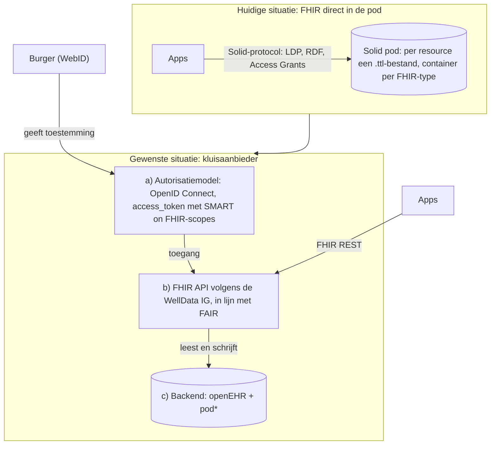

# Voorstel: memo over FHIR in Solid pods en een API voor de persoonlijke gegevenskluis

- **Status:** voorbereidend voorstel, werkdocument
- **Datum:** 23 oktober 2026, bijgewerkt 2 november 2026
- **Auteur:** Roland Groen
- **Werktitel memo:** *Van harde schijf naar persoonlijke gegevenskluis*

Dit voorstel bereidt een memo voor met twee delen: (A) de uitdagingen van het direct lezen en schrijven van FHIR in Solid pods, en (B) een oplossingsrichting: een API vaststellen, beschreven als FHIR Implementation Guide (IG), met als thema "persoonlijke gegevenskluis". Een kluisaanbieder biedt die kluis aan met een autorisatiemodel, de FHIR API als externe interface en een backend die primair werkt met openEHR en de pod*. Het voorstel verzamelt het bestaande materiaal, schetst de opbouw van de memo en zet de eerste stappen uit.

*) Andere implementaties van de backend zijn mogelijk.

> [!NOTE]
> Verwijzingen naar `documenten/` gaan naar lokaal verzameld bronmateriaal. Die map staat bewust in `.gitignore` en komt niet in de publieke repository.

## 1. Aanleiding

Het vraagstuk loopt al sinds de start van het technisch overleg in WP 3.2 en komt telkens terug:

| Wanneer | Wat |
| --- | --- |
| okt 2024 | In het eerste technisch overleg is de vraag naar het datamodel al open: "Standaarden als RDF en FHIR. OpenEHR?" |
| jan 2025 | Het WP 3.2-logboek noemt "some issues in using FHIR API combined with Solid standards"; bevragen van de pod (SPARQL) wordt niet standaard ondersteund. |
| mrt 2025 | *Technical Memo: Welldata Architecture*: Solid voor persoonlijke, sessiegebonden gegevens; aggregatie voor onderzoek niet via pull over alle pods. Ook: vindbaarheid en lokalisatie van gegevens in pods. |
| apr 2025 | In overleg vastgesteld dat het nabouwen van een FHIR-resourceserver in Solid pods niet werkt, onder meer omdat transacties in pods niet mogelijk zijn. |
| okt 2025 | Pre-pilot: geen validatie bij schrijven naar de pod ("er is een IG maar geen profiel"), problemen met overschrijven, vindbaarheid en organisatie van gegevens. In hetzelfde overleg een verwijzing naar openehr.org. |
| dec 2025 | Een pilotpartner escaleert een issue over het opslagformaat van FHIR in de pod en de brug tussen FHIR en Solid. FHIR-API beperkt tot Patient en Observation. |
| jan 2026 | De werkgroep zoekt een partij die "ten aller tijde consistente FHIR data produceert"; discussie over IG's en CapabilityStatements. |
| mrt 2026 | Eigen analyse: "Solid is een harde schijf", er ontbreken logische lagen; idee om gegevens als openEHR op te slaan. |
| apr 2026 | Problemen met de Inrupt Java-client ([issue #36](https://github.com/GIDSOpenStandaarden/welldata-implementation-guide/issues/36)); onderbouwing *FHIR API vs Direct Solid Pod Access*. |
| jul 2026 | IG-memo *Personal Data Vault (PDK) Architecture* (gestaged); afspraak om een whitepaper over FHIR en Solid te schrijven, met als richting "FHIR IG met datakluis er achter, in de kluis zoiets als openEHR". |

De details en letterlijke citaten staan in `documenten/overlegnotities-fhir-solid.md` en `documenten/logboek-wp32-fragmenten-fhir-solid.md`.

## 2. Doel van de memo

1. **Deel A: de uitdagingen van het direct lezen en schrijven van FHIR.** In de huidige situatie schrijven en lezen apps FHIR-resources direct in de Solid pod, als RDF. De [IG](https://gidsopenstandaarden.github.io/welldata-implementation-guide/) zegt dat niet in zoveel woorden, maar het volgt uit de voorgeschreven opslagstructuur: elke resource een eigen `.ttl`-bestand in een container per FHIR-type ([Shared Dynamic Data](https://gidsopenstandaarden.github.io/welldata-implementation-guide/dynamic-data.html)), met toegang via Access Grants ([Pod Access](https://gidsopenstandaarden.github.io/welldata-implementation-guide/pod-access.html)). De memo laat zien welke uitdagingen dat oplevert, in elk geval rond:
   - **het formaat (de representatie)**, dat bepalend is voor het gebruik;
   - **het ontbreken van gedetailleerde toegang**;
   - en verdere uitdagingen (zie 5.1).
2. **Deel B: de oplossingsrichting.** Een API vaststellen, beschreven als FHIR IG, met als thema **"persoonlijke gegevenskluis"**. Een kluisaanbieder biedt de kluis aan; de FHIR API is diens externe interface. De kluisaanbieder regelt drie dingen:
   - **a) Een autorisatiemodel op basis van OpenID Connect, met SMART on FHIR-scopes**: de applicatie is een eenvoudige OpenID Connect-client (afnemer, zoals een PGO); de autorisatieservice van de kluisaanbieder (bron, zoals een DVA) laat de burger inloggen met bijvoorbeeld DigiD of de GIDS private ID, de burger geeft kortdurende of langlopende toestemming, en de applicatie krijgt een access_token met SMART on FHIR-scopes (bij langlopende toestemming ook een refresh_token).
   - **b) De FHIR API**, die de gegevens volgens de IG beschikbaar maakt, in lijn met de FAIR-principes.
   - **c) Een backend**, die primair werkt met openEHR en de pod*. De backend is implementatie, geen architectuur.

   **Burgerregie** blijft het uitgangspunt: de kluis blijft van de burger.

   *) Andere implementaties van de backend zijn mogelijk.

**Wat de memo niet is:** geen afwijzing van Solid als idee (identiteit via WebID, toestemming en datasoevereiniteit blijven waardevol), geen productkeuze en geen volledig ontwerp.

## 3. Kernboodschap (werkhypothese)

> Wie FHIR direct in een Solid pod leest en schrijft, maakt de opslag tot de API. Daardoor bepaalt de representatie hoe gegevens bruikbaar zijn, en ontbreekt gedetailleerde toegang. Leg daarom een API vast, beschreven als FHIR IG met als thema de persoonlijke gegevenskluis. Een kluisaanbieder biedt die API aan als externe interface, met een autorisatiemodel dat toegang bepaalt op basis van attributen zoals toestemming, rol en medische context, en een backend die primair werkt met openEHR en de pod*.

### Voorschot

**Deel A: uitdagingen**

- **Het formaat (de representatie) bepaalt het gebruik.** FHIR is een uitwisselformaat, geen opslagformaat, en de manier van opslaan beïnvloedt de verdere werking. Voorbeeld: je kunt alle Observations samen in een Bundle opslaan of elk afzonderlijk. Sla je ze afzonderlijk op, dan moet je misschien honderden bestanden inlezen om er één te vinden. Sla je ze op in een Bundle, dan moet je misschien een Bundle met honderden Observations laden om er één te vinden. Queries op FHIR-resources zijn onmogelijk of sterk beperkt, ook met RDF.
- **Gedetailleerde toegang ontbreekt.** Toegang in Solid loopt via containers en bestanden; de indeling in bestanden bepaalt dus wat je wel of niet apart kunt delen. Daarbij is autorisatie in Solid pods op zichzelf al lastig (Access Grants als verifiable credentials, UMA, een WebID per applicatie).
- En zo zijn er meer; zie 5.1.

**Deel B: oplossingsrichting**

- Een kluisaanbieder biedt de persoonlijke gegevenskluis aan met (a) een autorisatiemodel op basis van SMART on FHIR-scopes, (b) de FHIR API volgens de IG als externe interface, in lijn met de FAIR-principes, en (c) een backend met openEHR en de pod*.

*) Andere implementaties van de backend zijn mogelijk.

## 4. Relatie met bestaand werk

| Document | Verhouding tot de nieuwe memo |
| --- | --- |
| [Shared Dynamic Data](https://gidsopenstandaarden.github.io/welldata-implementation-guide/dynamic-data.html) en [Pod Access](https://gidsopenstandaarden.github.io/welldata-implementation-guide/pod-access.html) (IG) | Beschrijven de huidige situatie: FHIR-resources als losse `.ttl`-bestanden in een container per type, toegang per container via Access Grants. Uitgangspunt van deel A. |
| [Personal Data Vault (PDK) Architecture](https://gidsopenstandaarden.github.io/welldata-implementation-guide/memo-personal-data-vault.html) (IG, gestaged) | Beschrijft de kluis (PDK) als architectuurrol achter een FHIR-contract en noemt het opslagsubstraat een implementatiedetail. Sluit direct aan op deel B: de nieuwe memo maakt daar een vast te stellen API van, met als thema de persoonlijke gegevenskluis. |
| [FHIR API vs Direct Solid Access](https://gidsopenstandaarden.github.io/welldata-implementation-guide/memo-fhir-api-vs-direct-solid-access.html) (IG, gestaged) | Onderbouwing waarom een FHIR API beter werkt dan directe toegang tot de pod. Levert argumenten voor deel A. |
| *Technical Memo: Welldata Architecture* (maart 2025) | Gaat over aggregatie en onderzoeksdata (Solid voor sessies, Nuts voor push). Complementair: de nieuwe memo gaat over de toegang tot en de opslag van persoonlijke gegevens. |

**Voorstel:** de nieuwe memo als vervolg op de PDK-memo schrijven, en voor het "waarom een FHIR API" verwijzen in plaats van herhalen.

## 5. Voorlopige opbouw van de memo

De memo volgt de lijn van pilot, via bevindingen, naar oplossing. Zo wordt eerst de gemaakte keuze beschreven en pas daarna beoordeeld.

1. **Samenvatting**
2. **De pilot en de gekozen oplossingsrichting:** WellData, de IG als WP 3.2-protocol, de pod-platforms (Athumi, We Are) en de pilots; de keuze voor FHIR als RDF direct in de pod met Access Grants, en waarom die keuze logisch was. Beschrijvend, met een plaat van de huidige situatie zonder oordeel.
3. **Bevindingen en knelpunten** (deel A)
   1. Het formaat (de representatie) bepaalt het gebruik
   2. Het ontbreken van gedetailleerde toegang
   3. Verdere knelpunten (selectie uit 5.1)
   4. Wat Solid zelf biedt of in ontwikkeling heeft (bijvoorbeeld Type Indexes, Solid Application Interoperability, Shape Trees, SHACL/ShEx-validatie, het Solid Notifications Protocol) en waarom dat de knelpunten wel of niet oplost
4. **De persoonlijke datakluis: FHIR-data met jouw zeggenschap:** de kluisaanbieder met a), b) en c) op hoofdlijnen, met een plaat van de gewenste situatie en per knelpunt de oplossing
5. **De oplossingsrichting in detail** (deel B)
   1. De FHIR API volgens de IG, in lijn met de FAIR-principes (zie 5.2)
   2. Het autorisatiemodel (zie 5.2)
   3. De backend: openEHR en de pod* (zie 5.3)
   4. Burgerregie, identiteit (WebID, Solid-OIDC, HTI) en portabiliteit
   5. Onderzoek en de EHDS: vindbaar via de NVI
6. **Risico's en open vragen**
7. **Aanbevelingen en vervolgstappen**

De gevolgen voor WellData en de IG (wat verandert er voor pilots, partners en de IG, en het migratiepad) horen bij een volgende iteratie en vallen buiten deze memo.

### 5.1 Uitdagingen (deel A), eerste inventaris

De kolom "Structureel?" is een eerste inschatting en moet in het werk worden getoetst. De lijst is niet uitputtend.

#### Het formaat (de representatie) bepaalt het gebruik

| # | Uitdaging | Waargenomen in WellData | Structureel? |
| --- | --- | --- | --- |
| 1 | FHIR is een uitwisselformaat, maar wordt als opslagformaat gebruikt. Losse bestanden of een Bundle: in beide gevallen moet je mogelijk honderden Observations lezen om er één te vinden. Een nieuwe FHIR-versie raakt bovendien de opgeslagen gegevens | De IG schrijft per resource een eigen `.ttl`-bestand voor ([Shared Dynamic Data](https://gidsopenstandaarden.github.io/welldata-implementation-guide/dynamic-data.html)); serialisatie keert steeds terug (RDF-demo's, RDF-export, JSON en JSON-LD naar Turtle omzetten, 2025 tot 2026); FHIR vanaf wearables naar de pod schrijven is "een stevige uitdaging" (aug 2025); escalatie over het opslagformaat (dec 2025); RDF-voorbeelden in de IG (branch `feature/finalize-fhir-rdf`) | Ja: een ontwerpkeuze, geen implementatiefout |
| 2 | Queries op FHIR-resources zijn onmogelijk of sterk beperkt, ook met RDF | Bevragen van de pod niet standaard ondersteund (jan 2025); discovery en indexering deels buiten de pod nodig (2025 tot 2026) | Ja, op protocolniveau |
| 3 | De opslagstructuur bepaalt waar gegevens staan en hoe je ze terugvindt: overschrijven, organisatie en vindbaarheid | Pre-pilot okt 2025; geen vaste vindplaats voor Patient, voorlopig een map per FHIR-type (feb 2026); apps maakten verschillende opslagkeuzes (2025); memo maart 2025 (discovery en lokalisatie) | Deels: conventies en Type Indexes, geen garanties |

#### Het ontbreken van gedetailleerde toegang

| # | Uitdaging | Waargenomen in WellData | Structureel? |
| --- | --- | --- | --- |
| 4 | De opslagkeuze bepaalt het autorisatiemodel | De IG verdeelt resources over containers per FHIR-type, zodat een app alleen toegang krijgt tot "the container where all questionnaireResponses are stored" ([Shared Dynamic Data](https://gidsopenstandaarden.github.io/welldata-implementation-guide/dynamic-data.html)). Fijnmaziger delen (bijvoorbeeld alleen bloeddruk of alleen de laatste maand) vraagt een andere bestandsindeling, en die raakt weer punt 1 tot en met 3 | Ja |
| 5 | Geen model om specifiek toegang toe te kennen | Er is een autorisatieservice (Access Grants als verifiable credentials via de Inrupt VC-service, omwisselen voor een token via UMA, een WebID per applicatie, [Pod Access](https://gidsopenstandaarden.github.io/welldata-implementation-guide/pod-access.html)), maar geen model om uit te drukken welke gegevens een app mag zien: niet in termen van de gegevens (type, code, periode), en niet op basis van rol, type applicatie of toepassing, medische context of breaking the glass. Voorbeeld: alleen de slaapscore delen en niet het gewicht. Open vragen over ACL per app of rol en granulariteit (2024 tot 2025) | Ja |
| 6 | Geen afgeschermd zoeken (search narrowing en filtering) | Een app krijgt een hele container of niets; filteren gebeurt pas in de app, nadat de gegevens zijn opgehaald | Ja |
| 7 | Langdurige toestemming | Wordt ondersteund: de app logt in met eigen client credentials (We Are IDP) en gebruikt een Access Grant om via UMA zonder sessie van de burger een token te krijgen; Access Grants hebben een vervaldatum en zijn intrekbaar. In We Are gold 24 uur; langer is technisch mogelijk en akkoord bevonden (aug 2025) | Geen knelpunt; het nieuwe model moet dit evenaren |

#### Verdere uitdagingen

| # | Uitdaging | Waargenomen in WellData | Structureel? |
| --- | --- | --- | --- |
| 8 | Validatie bij schrijven | Pre-pilot okt 2025: "er is een IG maar geen profiel". Inmiddels heeft de implementator van de pods schemavalidatie op basis van RDF geïmplementeerd; validatie hangt daarmee af van de pod-implementatie en is geen onderdeel van het contract | Deels opgelost |
| 9 | Geen transacties over meerdere resources | Genoemd in eigen overleg (april 2025); in het WP 3.2-logboek niet expliciet besproken, dus nog te onderbouwen met een concreet geval | Ja: elke resource is een los HTTP-verzoek |
| 10 | Versiebeheer | Een FHIR-server maakt eerdere versies opvraagbaar via `_history`; het Solid Protocol schrijft geen versiebeheer voor | Te toetsen per pod-implementatie |
| 10a | Afgedwongen metadata en herkomst | De pod-server zet wel een eigen `Last-Modified` per bestand, maar FHIR-metadata in de RDF (`meta.lastUpdated`, `meta.source`) schrijven apps zelf; niets garandeert dat die kloppen. Een FHIR-service zet tijdstip en versie zelf en kan herkomst koppelen aan de geauthenticeerde applicatie, zoals de extensie resource-origin in Koppeltaal 2.0 (verwijst naar het Device van de applicatie die eigenaar is) | Ja, zolang apps direct in de pod schrijven |
| 11 | Audit trail volgens NEN 7513 niet afgedwongen | Apps lezen en schrijven direct in de pod; er is geen centraal punt dat elke toegang vastlegt. De IG noemt ATNA en correlatie-ID's ("Audit Logging, in de POD?", feb 2025). Met een FHIR API wordt het audit trail afgedwongen; het audit trail zelf kan in de pod staan | Ja, zolang apps direct in de pod werken |
| 12 | Granulariteit en herkomst van (sensor)gegevens | Met welke granulariteit schrijf je sensordata weg (mrt 2026); herkomst via `Meta.source` | Te toetsen: deels een modelleervraag, los van Solid |
| 13 | Clientbibliotheken en tooling lopen achter | Inrupt Java-library "blijft lastig" (apr 2025); Java SDK niet compatibel, geforkt en gepatcht ([#36](https://github.com/GIDSOpenStandaarden/welldata-implementation-guide/issues/36)); leveranciers werken in .NET, Java en TypeScript | Nee, maar het remt adoptie |
| 14 | Aggregatie voor onderzoek en de EHDS | Analyseren over pods heen nog niet mogelijk (apr 2025); voorkeur voor een anoniem aggregerende dienst (mei 2025); memo maart 2025. De EHDS vraagt beschikbaarheid voor secundair gebruik via toegangsorganen en geeft de burger rechten op inzage en delen. Richting: de NVI publiceert het FHIR-endpoint van de kluis; toegang via de autorisatieservice op basis van veronderstelde toestemming (opt-out) | Ja, architectonisch |

### 5.2 Wat de kluisaanbieder regelt (eerste aanzet)

Hypotheses om in deel B uit te werken.

**a) Autorisatiemodel**

- **OpenID Connect, net als bij MedMij:** de applicatie is afnemer (zoals een PGO), de kluisaanbieder is bron (zoals een DVA). De applicatie doet een /authorize bij de autorisatieservice van de kluisaanbieder; die identificeert de burger (DigiD, GIDS private ID); de burger geeft kortdurende (access_token) of langlopende toestemming (ook refresh_token, scope `offline_access`). Op papier gelijkwaardig aan de huidige pod-oplossing (Access Requests, Access Grants, UMA), maar eenvoudiger en gebaseerd op bestaande standaarden (uitdaging 4 en 5).
- **Verdere logica in de autorisatieservice** op basis van onder andere rol, type applicatie of toepassing, medische context en breaking the glass. Te onderzoeken: de HL7-codes voor purpose of use, waaronder break the glass.
- **Langdurige toestemming** wordt nu al ondersteund met Access Grants (uitdaging 7); in het nieuwe model is dat in principe een refresh token (`offline_access`): bij elke vernieuwing controleert de autorisatieservice opnieuw de stand van zaken, voordat de schrijvende app een nieuw access_token krijgt.
- **Afgeschermd zoeken met scopes:** bijvoorbeeld `patient/Observation.rs?code=lifestyle-system|sleepscore` om alleen de slaapscore te delen (uitdaging 6). SMART App Launch 2 ondersteunt scopes met zoekparameters, maar servers zijn daar nog niet toe verplicht; de IG moet dat eisen.
- **Identiteit:** hoe WebID, Solid-OIDC, HTI en de huidige Access Grants zich verhouden tot het autorisatiemodel.
- **Audit trail:** de FHIR API dwingt een audit trail af volgens NEN 7513; het audit trail staat in de pod van de burger (uitdaging 11).

**b) FHIR API volgens de IG**

- **Profielen** voor de gegevens in de kluis, met de bestaande WellData-profielen als start.
- **Interacties en zoekparameters:** welke lees-, schrijf- en zoekvragen de kluis ondersteunt, vastgelegd in een CapabilityStatement. Zo ligt de representatie in het contract vast en niet in de bestandsindeling (uitdaging 1 tot en met 3).
- **Validatie bij schrijven** tegen de profielen (uitdaging 8).
- **Consistentie:** samenhangende resources atomair schrijven waar dat nodig is (uitdaging 9).
- **Metadata, herkomst en versiebeheer:** afgedwongen door de API (tijdstip, versie, herkomst via de geauthenticeerde applicatie) en `_history` (uitdaging 10 en 10a).
- **FAIR-principes:** de API dekt een open, gestandaardiseerd protocol met authenticatie en autorisatie waar nodig (A1, A1.1, A1.2), een gedeelde taal en vocabulaires (I1 tot en met I3), een gemeenschapsstandaard (R1.3) en afgedwongen herkomst (R1.2). Vindbaarheid over kluizen heen (F4) via de NVI, zie hieronder. Niet vanzelf gedekt: gebruiksvoorwaarden (R1.1, bij persoonsgegevens de toestemming).
- **Onderzoek en de EHDS:** de [Nationale Verwijsindex (NVI)](https://build.fhir.org/ig/nuts-foundation/nl-generic-functions-ig/branches/add-authorization-information-model/localization.html) uit de Generieke Functies (in consultatie) publiceert het FHIR-endpoint van de kluis; een onderzoeker of toegangsorgaan vraagt via de autorisatieservice een access_token aan, in principe alleen op basis van veronderstelde toestemming (opt-out) van de burger (uitdaging 14).
- **Export en portabiliteit:** hoe de burger de eigen gegevens kan meenemen naar een andere kluisaanbieder.

### 5.3 De backend: openEHR en de pod

De backend van de kluisaanbieder werkt primair met openEHR en de pod*: openEHR als klinisch model achter de API, met de gegevens in of gekoppeld aan de pod van de burger. De backend is implementatie, geen architectuur. Eerste vraag: wat houdt de koppeling precies in, bijvoorbeeld openEHR-composities in de pod, of een openEHR-repository die met de pod synchroniseert?

*) Andere implementaties van de backend zijn mogelijk.

Eigenschappen van openEHR om in de specificaties en implementaties te toetsen:

- **Tweelaagsmodellering:** een stabiel referentiemodel met daarboven klinische modellen (archetypes en templates), los van de versie van het uitwisselformaat.
- **Een EHR per persoon** als natuurlijke eenheid voor een persoonlijke kluis.
- **Versiebeheer en audit ingebouwd:** wijzigingen leveren nieuwe versies op; een *contribution* bundelt wijzigingen atomair.
- **AQL** als querytaal over de klinische modellen.
- **Bestaande bruggen naar FHIR:** het facadepatroon (EHRbase FHIR Bridge) en de mappingtaal FHIR Connect met de engine openFHIR.

## 6. Materiaal

### 6.1 Verzameld (lokaal in `documenten/`, niet in git)

| Bestand | Inhoud | Gebruik |
| --- | --- | --- |
| `documenten/fhir-api-vs-direct-solid-access.md` | Onderbouwing FHIR API boven Solid pods (april 2026), inclusief de nog niet gecommitte aanpassing van argument 1 | Deel A, argumenten |
| `documenten/reactie-frederik-fhir-vs-solid.md` | Nederlandstalige reactie aan VITO met tien argumenten (april 2026) | Deel A, Nederlandse formuleringen |
| `documenten/technical-memo-welldata-architecture-2025-03.md` | Technical Memo van maart 2025 | Context, aggregatie, vindbaarheid |
| `documenten/notulen-welldata-tech-overleg-2024.md` | Eerste technisch overleg (okt 2024), openEHR al als vraag | Aanleiding |
| `documenten/overlegnotities-fhir-solid.md` | Gedateerde citaten uit overleggen, 2024 tot 2026 | Aanleiding, bewijs per uitdaging |
| `documenten/logboek-wp32-fragmenten-fhir-solid.md` | Fragmenten uit het WP 3.2-logboek, per thema | Bewijs per uitdaging |
| `documenten/wp3-techniek.md`, `documenten/README.md` | Samenvattingen van de WellData-projectdocumenten | Context en besluiten |

### 6.2 In deze repository

- Huidige situatie: [Shared Dynamic Data](https://gidsopenstandaarden.github.io/welldata-implementation-guide/dynamic-data.html) (opslagstructuur in de pod), [Pod Access](https://gidsopenstandaarden.github.io/welldata-implementation-guide/pod-access.html) en [Accessing the Pod](https://gidsopenstandaarden.github.io/welldata-implementation-guide/technical-pod-access.html) (toegang)
- Memo's: [Personal Data Vault (PDK) Architecture](https://gidsopenstandaarden.github.io/welldata-implementation-guide/memo-personal-data-vault.html), [FHIR API vs Direct Solid Access](https://gidsopenstandaarden.github.io/welldata-implementation-guide/memo-fhir-api-vs-direct-solid-access.html)
- Profielen in [de IG (Artifacts)](https://gidsopenstandaarden.github.io/welldata-implementation-guide/artifacts.html) en de RDF-voorbeelden op de branch `feature/finalize-fhir-rdf`

### 6.3 Externe bronnen (eerste selectie, nog te lezen)

Solid en FHIR:

- Solid Protocol: <https://solidproject.org/TR/protocol>
- FHIR RDF (R4): <https://hl7.org/fhir/R4/rdf.html>
- Solid in de zorg: [VITO We Are case study (Inrupt)](https://inrupt.com/case-study/vito-securely-shares-personal-health-data-using-solid), [TIDAL: Analyze Decentralized Personal Health Data using Solid, Digital Consent, and Federated Learning](https://cris.maastrichtuniversity.nl/en/publications/analyze-decentralized-personal-health-data-using-solid-digital-co/)

De API en het toegangsmodel:

- SMART App Launch, scopes: <https://hl7.org/fhir/smart-app-launch/scopes-and-launch-context.html>
- Nationale Verwijsindex (Generieke Functies, in consultatie): <https://build.fhir.org/ig/nuts-foundation/nl-generic-functions-ig/branches/add-authorization-information-model/localization.html>
- FAIR-principes: <https://www.gofair.foundation/fair-principles>

openEHR en de pod als backend:

- openEHR-specificaties: <https://specifications.openehr.org/>
- Facadepatroon en EHRbase FHIR Bridge: [Vendor neutral interoperability with openEHR and HL7 FHIR, deel 1](https://hip.vitagroup.ag/tech-blog/vendor-neutral-interoperability-openehr-hl7-fhir-part1/)
- FHIR Connect: [mapping-specificatie](https://github.com/better-care/fhir-connect-mapping-spec), [artikel "FHIRconnect: Towards a seamless integration of openEHR and FHIR" (2025)](https://arxiv.org/abs/2511.14618), [openFHIR van Medblocks](https://medblocks.com/blog/announcing-medblocks-openfhir-an-open-source-engine-that-bridges-openehr-and-fhir)
- Discussie in de openEHR-community: [Relationship between FHIR and openEHR](https://discourse.openehr.org/t/relationship-between-fhir-and-openehr/236)

### 6.4 Nog te verzamelen

Deel A:

- [ ] Een uitgewerkt rekenvoorbeeld voor uitdaging 1: hoeveel bestanden of Bundles een app moet lezen voor een typische vraag (bijvoorbeeld de laatste gewichtsmeting)
- [ ] Concrete toegangsvragen uit de pilots: welke gedetailleerde toegang hebben burgers en apps nodig (per type, per code, per periode, per doel)?
- [ ] De oorspronkelijke melding van de pilotpartner over het opslagformaat (december 2025)
- [ ] Bevindingen uit de pre-pilots (WP4) over overschrijven en vindbaarheid, met concrete voorbeelden
- [ ] Hoe de pod-platforms (Athumi, We Are) omgaan met validatie, versiebeheer en zoeken
- [ ] De "JK research memo" (maart 2025) over pods, applicaties en Nuts

Deel B:

- [ ] Bestaande API's en IG's voor persoonlijke gegevens om op aan te sluiten, bijvoorbeeld in de PGO-context in Nederland
- [ ] EHDS-eisen aan opslag en uitwisseling die de API beïnvloeden
- [ ] De roadmapslides van VITO voor WP 5.3 (april 2026)
- [ ] Wat MedMij heeft vastgelegd voor de flow tussen PGO en DVA (identificatie met DigiD, toestemming, tokens) en wat daarvan herbruikbaar is voor de kluisaanbieder
- [ ] Bestaande autorisatiemodellen voor persoonlijke gegevens (bijvoorbeeld SMART on FHIR, UMA, attribuutgebaseerde toegang) en hoe die toestemming eenmalig, tijdelijk, langdurig of onder voorwaarden vastleggen
- [ ] Navragen bij de pod-implementator hoe de RDF-schemavalidatie werkt en of die de profielen uit de IG dekt
- [ ] Welke eisen NEN 7513 stelt aan het audit trail van toegang tot WellData-gegevens, en hoe dat in de pod wordt opgeslagen
- [ ] Of de NVI, die nu uitgaat van zorgaanbieders (URA) en een gepseudonimiseerd BSN, past bij kluisaanbieders en bij WellData zonder BSN
- [ ] De extensie resource-origin in Koppeltaal 2.0 als voorbeeld voor afgedwongen herkomst
- [ ] Welke EHDS-verplichtingen (primair en secundair gebruik) voor WellData-gegevens gelden
- [ ] openEHR en de pod: openEHR-gebruik in NL en BE, ervaringen met openEHR voor persoonlijke gezondheidsomgevingen, en bruikbare archetypes voor de WellData-basisset

## 7. Open vragen en keuzes

1. **Doelgroep en taal.** Voorstel: primair de technische werkgroep WP 3.2 en de partners in Vlaanderen en Nederland. Engels sluit aan bij de IG-pagina's, Nederlands bij het werkoverleg.
2. **Vorm en plek.** Een IG-pagina onder "Memo's and Reviews", een losse memo voor review (bijvoorbeeld als Google Doc), of beide?
3. **Term.** "Persoonlijke gegevenskluis" of "Persoonlijke Data Kluis (PDK)" zoals in de bestaande IG-memo? Eén term kiezen en die in de IG doorvoeren.
4. **Scope van de API.** Alleen de WellData-basisset, of breder: een generieke API voor de persoonlijke gegevenskluis?
5. **Uitwerking van de backend.** openEHR en de pod horen bij de implementatie, niet bij de architectuur. Krijgt de backend een eigen paragraaf of bijlage in de memo, of blijft het bij een korte beschrijving?
6. **Toon tegenover Solid.** Deel A raakt de kern van de projectarchitectuur. Hoe brengen we het zo dat het als verbetering en niet als afwijzing landt?
7. **Co-auteurs en reviewers.** Wie schrijft mee, en wie leest de eerste versie?

## 8. Werkwijze en eerste stappen

1. **Materiaal compleet maken**: de lijst in 6.4 aflopen; bronnen samenvatten in `documenten/`.
2. **Uitdagingen aanscherpen (deel A)**: per uitdaging bewijs, oorzaak en de eerlijke tegenwerping vanuit Solid, met het rekenvoorbeeld voor uitdaging 1.
3. **Eerste schets van de kluisaanbieder (deel B)**: het autorisatiemodel en de CapabilityStatement van de FHIR API, uitgaande van de huidige WellData-profielen.
4. **Verkenning van de backend**: openEHR en de pod, om de koppeling met de FHIR API concreet te maken.
5. **Eerste versie van de memo** schrijven en kort laten reviewen.
6. **Review en publicatie**: na de keuzes uit hoofdstuk 7.

De memo zelf komt in `memos/` naast dit voorstel; het bronmateriaal blijft in `documenten/`.
